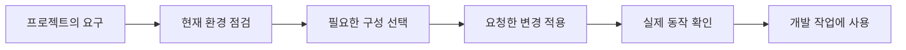

# Windows Agent Devkit

Windows에서 AI 에이전트와 개발 도구를 사용하는 환경을 제안하고, 그 환경의 점검·설정·사용을 돕는 로컬 Codex 플러그인을 만드는 프로젝트입니다.

[프로젝트 범위](docs/project-scope.md) · [권장 Windows 개발환경](docs/windows-environment.md) · [환경 점검 설계안](docs/environment-checks.md) · [플러그인 범위](docs/plugin-scope.md) · [다음 작업](docs/roadmap.md)

## 현재 상태

공식 자료를 조사해 권장 개발환경과 플러그인 점검 설계안을 정리한 단계입니다.
개발환경의 도구 선택과 점검 ID는 제안 상태입니다.
지원할 언어·도구 계열은 Node.js·Python·Go·Rust·Zig·C#으로 정했습니다.
공통 실행환경의 범위에는 Windows 네이티브·WSL 2·Docker 기반 Linux 컨테이너를 포함합니다.
개발 서비스의 관리 도구로 Lazydocker와 Process Compose를 권장합니다.
Windows 네이티브의 기본 대화형 개발과 관리 작업에는 PowerShell 7.6 LTS를 권장합니다.
데스크톱 앱의 통합 터미널과 에이전트 셸은 별도로 점검합니다.
실행 가능한 플러그인과 환경 변경 기능은 아직 구현하지 않았습니다.

## 만들려는 것

| 산출물 | 목적 |
| --- | --- |
| 권장 Windows 개발환경 | 구성 요소의 역할, 선택 이유, 적용 조건을 설명합니다. |
| 환경 점검 기능 | 현재 환경에서 확인한 사실과 부족한 조건을 정리합니다. |
| 환경 설정 기능 | 요청한 구성과 현재 상태의 차이를 바탕으로 필요한 변경을 적용합니다. |
| 환경 사용 기능 | 해당 환경에서 프로젝트의 개발·빌드·테스트 작업을 돕습니다. |

각 기능은 계획이며 현재 제공되는 명령을 뜻하지 않습니다.

## 개발 방향

프로젝트에서 이미 사용하는 런타임과 패키지 관리 방식을 먼저 확인합니다.
기존 도구가 정상 동작해도 공통 권장 구성과 전환안을 제안합니다.
전환안은 프로젝트의 런타임 버전과 패키지 관리자 선택을 보존합니다.
기존 구성을 유지하는 선택에는 적용 범위와 이유를 기록합니다.
Windows 네이티브 환경과 WSL은 프로젝트의 실행 조건에 따라 선택합니다.
제안한 구성과 실제로 검증한 결과를 구분합니다.

다음 구현 대상은 환경을 변경하지 않고 현재 상태를 확인하는 점검 기능입니다.
도구별 역할과 선택 이유는 [권장 환경](docs/windows-environment.md)에 기록했습니다.
점검의 입력·판정·결과 예시는 [환경 점검 설계안](docs/environment-checks.md)에 기록했습니다.
세부 항목과 순서는 [다음 작업](docs/roadmap.md)에 기록합니다.
