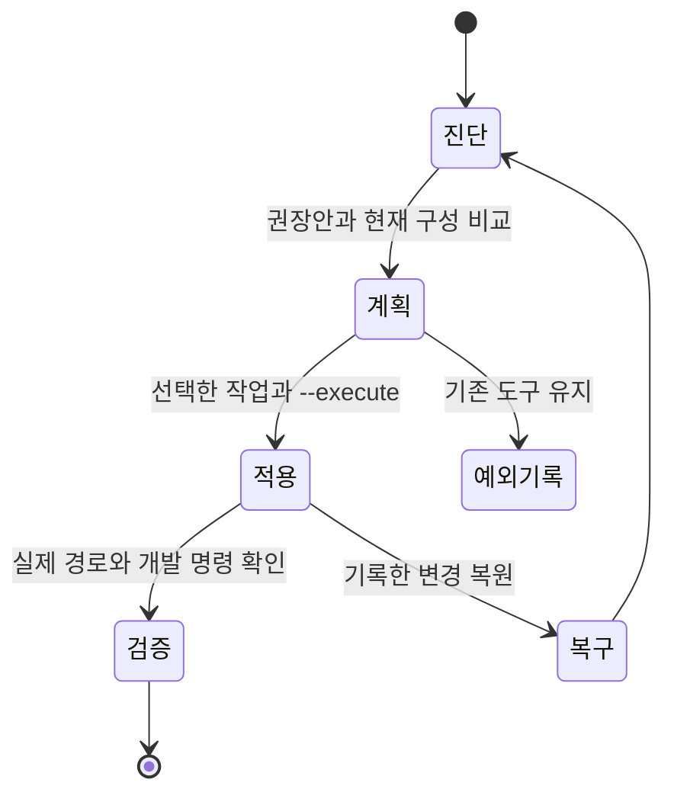

# Windows Agent Devkit

Windows 개발 프로젝트의 선언과 실제 도구 선택을 점검하고, 요청한 환경 변경과 실행 검증을 돕는 로컬 Codex 플러그인입니다.
Node.js·Python·Go·Rust·Zig·C#과 Windows 네이티브·WSL 2·Docker·Process Compose를 대상으로 합니다.

[권장 개발환경](docs/windows-environment.md) · [CLI 사용법](docs/diagnostic-cli.md) · [30개 점검 항목](docs/environment-checks.md) · [검증 기록](docs/verification.md)

## 빠른 시작

실행 환경은 Windows 11 x64, Node.js 24 이상, PowerShell 7입니다.
PowerShell 권장 계열은 7.6 LTS입니다.
저장소 개발 시에는 고정한 의존성을 설치한 뒤 CLI를 빌드합니다.

```powershell
npm ci --ignore-scripts
node scripts/build.mjs
node dist/cli.mjs doctor --project . --format json
```

doctor는 30개 ID의 적용 여부·경로·버전·호환성·권장 구성 차이를 JSON이나 한국어 텍스트로 반환합니다.
기본 진단은 프로젝트 코드와 서비스를 실행하지 않습니다.
`unknown`은 근거가 부족한 상태입니다.
`skipped`는 선택하지 않았거나 필요하지 않은 검사입니다.
전체 환경의 성공 여부와 각 검사의 확인 범위를 구분합니다.

## 로컬 플러그인 설치

```powershell
node scripts/package-plugin.mjs
codex plugin marketplace add ./.local/plugin-marketplace --json
codex plugin add windows-agent-devkit@windows-agent-devkit-local --json
codex plugin list --marketplace windows-agent-devkit-local --json
```

앱의 플러그인 화면을 새로 고친 뒤 Windows Agent Devkit을 확인합니다.
새 대화에서 `$environment-doctor`로 대상 프로젝트의 점검을 요청합니다.
설치 패키지에는 의존성을 포함한 CLI가 들어 있습니다.
설치된 플러그인 디렉터리에서 npm install을 실행할 필요가 없습니다.
로컬 설치는 계정의 공개 디렉터리 제출과 별개입니다.

| Skill | 용도 |
| --- | --- |
| `environment-doctor` | 프로젝트 선언·호스트 경로·30개 점검 항목과 권장 구성 비교 |
| `environment-setup` | 고정 버전의 변경 계획·적용·복구·유지 예외 기록 |
| `environment-validate` | 선택한 프로젝트 명령과 WSL·Docker·Process Compose의 실행 검증 |

## 변경 계획과 실행

계획은 프로젝트의 런타임·패키지 관리자·잠금 파일·빌드 명령·CI를 보존합니다.
기존 선언과 다른 버전은 자동으로 덮어쓰지 않습니다.
설치할 도구에는 정확한 버전을 지정합니다.
프로필은 선택한 경로에만 관리 블록을 추가합니다.

```powershell
node dist/cli.mjs plan --project C:/work/app --roles runtime-version-manager --versions node=24.18.1 --format json --output C:/work/app-plan.json
node dist/cli.mjs apply --project C:/work/app --plan C:/work/app-plan.json --execute --format json
node dist/cli.mjs rollback --project C:/work/app --journal <반환된-저널-ID> --execute --format json
```

명령의 버전은 형식을 보여주는 예시입니다.
실제 버전은 해당 프로젝트의 선언과 공식 릴리스에서 선택합니다.
개인 상태 디렉터리에 계획·백업·저널을 저장합니다.
동시 편집이나 계획의 변경을 발견하면 충돌로 처리합니다.
공유 도구 설치의 제거는 자동 복구에 포함하지 않습니다.



## 실행 검증

`validate --execute`는 선택한 대상에서만 코드나 서비스를 실행합니다.
Docker 검증은 명시한 context와 기존 이미지 또는 선택한 Compose 서비스를 사용합니다.
Process Compose는 시작·준비 검사·종료를 구분합니다.
Windows 프로젝트의 기존 명령은 신뢰한 task JSON으로 전달합니다.
사용 예시와 정리 제한은 [CLI 사용법](docs/diagnostic-cli.md)에 기록합니다.

## 개발과 확인

```powershell
node --test
node scripts/build.mjs
node scripts/check-package.mjs
node scripts/package-plugin.mjs
```

Windows CI에서 동작 테스트와 설치 패키지 검사를 실행합니다.
실제 호스트에서 확인한 기능과 모의 실행으로 확인한 기능은 [검증 기록](docs/verification.md)에서 구분합니다.
공식 지원 판정은 확인일과 유효기간이 있는 오프라인 정책을 사용합니다.
지원 계열 판정은 최신 패치나 취약점 검사를 뜻하지 않습니다.
지원하지 않는 동적 설정과 확인하지 못한 실행 문맥은 미확인으로 남깁니다.

전체 범위와 적용 제한은 [프로젝트 범위](docs/project-scope.md)에 기록합니다.
