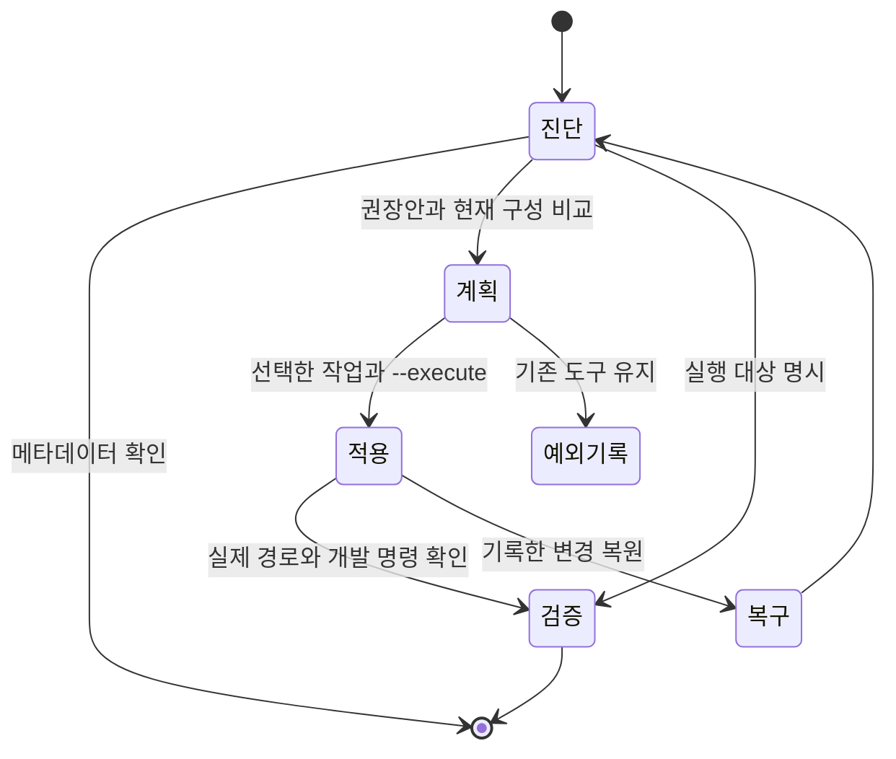

# Windows Agent Devkit

Windows 개발 프로젝트의 선언과 실제 도구 선택을 점검하고, 요청한 환경 변경과 실행 검증을 돕는 로컬 Codex 플러그인입니다.
Node.js·Python·Go·Rust·Zig·C#과 Windows 네이티브·WSL 2·Docker·Process Compose를 대상으로 합니다.

[권장 개발환경](docs/windows-environment.md) · [작업 실행기 선택](docs/task-runners.md) · [CLI 사용법](docs/diagnostic-cli.md) · [30개 점검 항목](docs/environment-checks.md)

배포 버전과 테스트·CI·실제 Codex 앱 호출 결과는 [검증 기록](docs/verification.md)에서 확인합니다.

## 설치본 빠른 시작

실행 환경은 Windows 11 x64, Node.js 24 이상, PowerShell 7입니다.
PowerShell 권장 계열은 7.6 LTS입니다.
먼저 [로컬 플러그인 설치](#로컬-플러그인-설치)를 마치고 점검할 프로젝트 디렉터리를 준비합니다.
`$pluginRoot`에는 설치본의 `skills/environment-doctor/SKILL.md`가 있는 디렉터리에서 두 단계 위의 실제 절대 경로를 넣습니다.
`$projectRoot`에는 이미 존재하는 대상 프로젝트의 절대 경로를 넣습니다.
이후 CLI 예시는 이 두 경로를 사용합니다.

```powershell
$pluginRoot = 'C:/path/to/installed/windows-agent-devkit'
$projectRoot = 'C:/src/example'
$cli = Join-Path $pluginRoot 'dist/cli.mjs'
node $cli doctor --project $projectRoot --format json
```

`doctor`는 30개 ID의 적용 여부·경로·버전·호환성·권장 구성 차이를 JSON이나 한국어 텍스트로 반환합니다.
기본 진단은 프로젝트 코드와 서비스를 실행하지 않습니다.
작업 실행기 설정은 정적으로 탐지합니다.
includes와 지원하지 않는 동적 문법은 `unknown`으로 남깁니다.
목록 조회와 dry run도 설정을 평가할 수 있으므로 자동 실행하지 않습니다.
`unknown`은 근거가 부족한 상태입니다.
`skipped`는 실행 범위나 선행 조건에 따라 검사를 생략한 상태입니다.
전체 환경의 성공 여부와 각 검사의 확인 범위를 구분합니다.

## 로컬 플러그인 설치

저장소 루트에서 [개발과 확인](#개발과-확인)의 패키지 생성과 검사를 마칩니다.
같은 저장소 루트에서 생성한 로컬 마켓플레이스를 등록하고 플러그인을 설치합니다.

```powershell
codex plugin marketplace add ./.local/plugin-marketplace --json
codex plugin add windows-agent-devkit@windows-agent-devkit-local --json
codex plugin list --marketplace windows-agent-devkit-local --json
```

앱의 플러그인 화면을 새로 고친 뒤 Windows Agent Devkit을 확인합니다.
새 대화에서 `$environment-doctor`로 대상 프로젝트의 점검을 요청합니다.
설치 패키지에는 의존성을 포함한 CLI가 들어 있습니다.
로컬 설치는 계정의 공개 디렉터리 제출과 별개입니다.

| Skill | 용도 |
| --- | --- |
| `environment-doctor` | 프로젝트 선언·호스트 경로·30개 점검 항목과 권장 구성 비교 |
| `environment-setup` | 고정 버전의 변경 계획·적용·복구·유지 예외 기록 |
| `environment-validate` | 선택한 프로젝트 명령과 WSL·Docker·Process Compose의 실행 검증 및 승인한 WSL 작업 등록 |

## 변경 계획과 실행

계획은 프로젝트의 런타임·패키지 관리자·잠금 파일·빌드 명령·CI를 보존합니다.
기존 선언과 다른 버전은 자동으로 덮어쓰지 않습니다.
설치할 도구에는 정확한 버전을 지정합니다.
프로필은 선택한 경로에만 관리 블록을 추가합니다.
새 계획을 저장할 파일 경로를 지정합니다.

```powershell
$planFile = 'C:/src/example-plan.json'
node $cli plan --project $projectRoot --roles runtime-version-manager --versions node=24.18.1 --format json --output $planFile
```

명령의 버전은 형식을 보여주는 예시입니다.
실제 버전은 해당 프로젝트의 선언과 공식 릴리스에서 선택합니다.
계획을 검토한 뒤 적용합니다.

```powershell
node $cli apply --project $projectRoot --plan $planFile --execute --format json
```

복구를 선택한 경우 적용에서 반환한 저널 ID를 넣습니다.

```powershell
node $cli rollback --project $projectRoot --journal '<반환된 저널 ID>' --execute --format json
```

개인 상태 디렉터리에 계획·백업·저널을 저장합니다.
동시 편집이나 계획의 변경을 발견하면 충돌로 처리합니다.
공유 도구 설치의 제거는 자동 복구에 포함하지 않습니다.



## 실행 검증

실행 대상을 선택하지 않은 상태에서 메타데이터만 확인하려면 `doctor`를 사용합니다.
`validate --execute`는 선택한 대상에서만 코드나 서비스를 실행합니다.
Rust 링크 검증은 `--rust-targets` 또는 작업 JSON의 `context: "rust"`로 요청합니다.
WSL 검증에는 배포판 이름과 Linux 절대 작업 경로가 필요합니다.
`validate --execute`에서 명시적으로 선택한 검증 항목이 `unknown` 또는 `skipped`이면 종료 코드는 1입니다.
Docker 검증은 명시한 context와 기존 이미지 또는 선택한 Compose 서비스를 사용합니다.
Process Compose는 시작·준비 검사·종료를 구분합니다.
Windows 프로젝트의 기존 명령은 신뢰한 task JSON으로 전달합니다.
`--task-file`은 플러그인 JSON을 읽으며 Go Task의 Taskfile을 받는 옵션이 아닙니다.
실행기 선택은 `mise`·`task`·`just`·`make`와 문자열 인수 배열을 사용합니다.
`mise run check`는 `tool: "mise"`, `args: ["run", "check"]`로 전달합니다.
선택 항목 `cwd`는 프로젝트 내부의 경로를 사용합니다.
선택 항목 `env`의 값과 원시 명령 출력은 보고서에 넣지 않습니다.
플러그인 경유 mise 실행은 자동 설치를 비활성화합니다.
작업 JSON의 신뢰 표시는 mise 설정의 신뢰 상태를 자동 승격하지 않습니다.
사용 예시와 정리 제한은 [CLI 사용법](docs/diagnostic-cli.md)에 기록합니다.

신규 다중언어 프로젝트의 공통 작업 진입점에는 mise tasks를 기본 권장합니다.
기존 Task·just·Make·npm scripts에는 권장 차이와 전환안 또는 유지 사유를 제시합니다.
기존 명령의 자동 변환과 실행기의 필수 설치는 수행하지 않습니다.
역할·선택·Windows 셸·CI 연계의 예시는 [작업 실행기 가이드](docs/task-runners.md)에 기록합니다.

## 승인한 WSL 작업 등록

0.3.2에서는 사용자가 반복 실행하도록 선택한 기존 WSL 작업을 Windows 프로젝트에 등록하는 절차를 제공합니다.
`wsl-register`가 보여 주는 범위와 작업 JSON을 검토한 뒤 반환된 지문으로 등록합니다.
등록은 전용 Windows 실행 파일과 해당 프로젝트의 `.codex/rules/` 규칙을 만듭니다.
신뢰된 프로젝트의 새 Codex 대화에서 전용 실행 파일의 절대 경로를 인수 없이 호출합니다.
`wsl-tasks`로 등록을 확인하고 `wsl-unregister --execute`로 철회합니다.
등록 전제조건과 Linux Makefile·Taskfile 예시는 [승인한 WSL 작업 등록 가이드](docs/wsl-task-registration.md)에서 확인합니다.

## 개발과 확인

다음 명령은 저장소 루트에서 순서대로 실행합니다.

```powershell
npm ci --ignore-scripts
node scripts/build.mjs
node --test
node scripts/check-package.mjs
node scripts/package-plugin.mjs
node scripts/check-package.mjs --packaged
```

Windows CI에서 동작 테스트와 설치 패키지 검사를 실행합니다.
소스 검사는 저장소의 `dist/cli.mjs`가 현재 빌드와 일치하는지 확인합니다.
`--packaged`는 생성한 패키지의 번들을 현재 소스에서 다시 빌드한 바이트와 대조한 뒤 독립 실행을 검사합니다.
공식 지원 판정은 확인일과 유효기간이 있는 오프라인 정책을 사용합니다.
지원 계열 판정은 최신 패치나 취약점 검사를 뜻하지 않습니다.
지원하지 않는 동적 설정과 확인하지 못한 실행 문맥은 미확인으로 남깁니다.

전체 범위와 적용 제한은 [프로젝트 범위](docs/project-scope.md)에 기록합니다.
