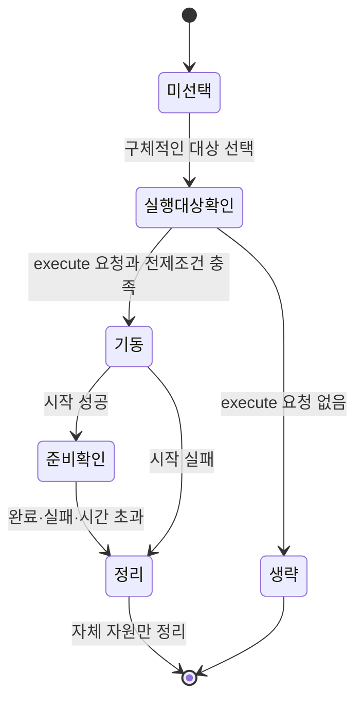
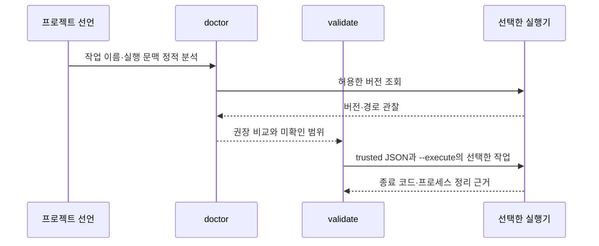

# 0.3.0 모듈 계약

이 문서는 0.3.0 구현의 모듈 사이 입력과 반환 계약을 기록합니다.
기준일은 2026-11-17입니다.
실제 호스트와 앱의 검증 상태는 [검증 기록](verification.md)에서 별도로 관리합니다.
명령 형식은 [진단 CLI 사용법](diagnostic-cli.md)을 따릅니다.

## 공통 계약

Node.js 24 이상과 PowerShell 7을 실행 기준으로 사용합니다.
기본 진단은 정적 분석과 허용한 읽기 전용 조회로 구성합니다.
적용·유지 예외 저장·실행 검증의 CLI 경로는 `--execute`로 구분합니다.
소스 설정·환경 값·인증 값·원시 명령 출력은 사용자 보고서에 복사하지 않습니다.
조회 실패와 요구 위반은 서로 다른 결과입니다.

`doctor`는 P0 22개와 P1 8개를 합친 30개 ID를 보고합니다.
판정은 `pass`, `fail`, `warn`, `unknown`, `skipped`를 사용합니다.
적용 대상·경로 해석·실행·호환성·공식 지원·권장 차이는 별도 필드입니다.
선택하지 않은 실행 검증을 통과로 바꾸지 않습니다.

## 프로젝트 분석

`analyzeProject(projectPath)`는 `{root, requirements, environment, files, issues, metadata}`를 반환합니다.
`requirements`의 키는 `node`, `python`, `go`, `rust`, `zig`, `dotnet`입니다.
각 언어는 `{state, versionRequests, packageManagers, lockFiles, metadata, notes}`를 유지합니다.
요구 상태는 `required | not_required | unknown`입니다.
버전 요청은 `{source, field, kind, value}`입니다.
버전 종류는 `exact`, `minimum`, `range`, `channel`, `preferred`, `sdk`입니다.
`environment`는 `containers`와 `processCompose`의 요구 상태입니다.
`issues`의 각 항목은 `{source, message}`입니다.

| 최상위 메타데이터 | 현재 계약 |
| --- | --- |
| `scope` | `boundary`, `boundaryKind`, `ancestorDirectories`, `maxDepth`, `maxFiles`, `maxBytes`입니다. |
| `declarations[]` | `source`, `kind`, `scope`, `distance`, `selectedLanguages`, 선택적 `unresolvedFields`입니다. |
| `workspaces[]` | `source`, `kind`, `state`, `patterns`, `members`, `notes`, 선택적 `root`입니다. |
| `ci[]` | `source`, `provider`, `state`, `jobs`, `notes`입니다. |
| `taskRunners[]` | `tool`, `source`, `state`, `tasks`, `notes`와 선택적 `taskDetails`입니다. |
| `taskRunnerCI[]` | `source`, `job`, `step`, `tool`, `state`, 선택적 `task`, `executionLocation`입니다. |
| `processCompose` | `source`, `sources`, `services`, `dynamicEnvironment`, `configurations`, 선택적 `shell`입니다. |
| `compose` | `sources`, `services`, `dynamicEnvironment`, `configurations`입니다. |
| `devcontainer` | 있는 경우 `source`, `runtimeLocation`, `configurations`, 선택적 `composeFiles`입니다. |
| `pythonVenv` | 있는 경우 `{environments}`입니다. |
| `dockerfiles[]` | `{source, runtimeLocation}`입니다. |
| `execution` | `location`, 여섯 언어의 `hostLanguages`, 근거 배열 `evidence`입니다. |

Process Compose 요약의 셸은 `{command, argument?}`입니다.
서비스 요약은 `{name, source, workingDir?, dependencies, healthCheck}`입니다.
`dependencies`는 서비스 이름 배열입니다.
`healthCheck`는 `{defined, type?, port?}`입니다.
Compose 서비스 요약은 `{name, source, image?, build?, profiles?}`입니다.
설정별 `configurations`는 셸·경로·의존 조건·건강 확인·포트의 정적 상태와 미확인 사유를 보존합니다.

`execution.location`은 `host | container | unknown`입니다.
`execution.hostLanguages`는 언어별 호스트 적용 상태입니다.
`execution.evidence[]`는 `{source, kind, location, reason}`입니다.
단독 Compose는 호스트 언어 적용을 자동 제외하지 않습니다.
유효한 devcontainer는 선택한 컨테이너 작업 문맥을 명시합니다.

CI 요구는 언어별 `metadata.ciRequirements`에도 기록합니다.
이 항목은 `source`, `job`, `step`, `language`, `field`, `state`, `versionRequests`, `executionLocation`, `notes`와 선택적 `versionFile`을 포함합니다.
CI 행렬의 대안 버전을 로컬 요청의 교집합에 넣지 않습니다.
Python의 `metadata.virtualEnvironments`는 `pythonVenv.environments`와 같은 관찰입니다.
가상환경 버전은 프로젝트의 버전 요구를 대체하지 않습니다.

## 호스트와 조회

`inspectWindows({projectPath, timeoutMs, tools})`는 `{context, commands, probes}`를 반환합니다.
`context.diagnosticShell`은 셸의 이름·경로·버전과 프로필 적용 여부를 기록합니다.
명령 후보와 실제 조회 실행 파일은 구분합니다.
실행 파일은 경로·일반 파일 여부·PE 형식 등의 검증을 통과해야 합니다.
검증되지 않은 wrapper·proxy·shim의 실행은 보류합니다.
로컬 CIM 조회가 거부되면 프로세스·레지스트리 메타데이터의 읽기 전용 대체 경로를 사용합니다.
이 대체 경로는 샌드박스 권한 완화를 요청하지 않습니다.

`createQuery({projectPath, host, timeoutMs, environment, run})`는 `query(tool, args, options)`를 반환합니다.
기본 조회는 고정된 도구와 읽기 전용 인수 배열만 허용합니다.
반환값은 `state`, `stdout`, `stderr`, `exitCode`, `executable`, `arguments`, 선택적 `reason`을 포함합니다.
`stdout`과 `stderr`는 내부 해석용이며 보고서의 공개 계약이 아닙니다.
각 진단 모듈은 필요한 값만 추출하고 원시 출력을 제거합니다.
명시적인 실행 경로는 `options.execute: true`로 구분합니다.

## 추가 진단과 인프라

`collectAdvanced({projectPath, project, host, timeoutMs, query})`는 `{checks, observations}`를 반환합니다.
담당 ID는 `TOOLS-01`, `DOTNET-01`, `GIT-01`, `GIT-02`, `IDE-01`, `AUX-01`, `STORE-01`입니다.
mise 설치 목록과 실제 경로, .NET SDK 선택과 런타임 목록을 구분합니다.
Git 인증 도우미와 정책은 허용한 메타데이터로 제한합니다.
IDE·보조 도구·저장소 볼륨은 요청과 적용 근거에 따라 조회합니다.

`collectInfrastructure({project, host, options, query})`는 `{checks}`를 반환합니다.
담당 ID는 `NODE-02`, `PY-02`, `WSL-01`, `CTR-01`, `LD-01`, `PC-01`입니다.
Docker context와 Compose 버전 조회를 엔진 기동·연결 검증과 구분합니다.
서비스 설정의 정적 확인을 실제 서비스 준비 완료로 바꾸지 않습니다.
앱 점검 `CODEX-01`은 통합 보고서에서 별도 선택 문맥으로 처리합니다.
`src/app-check.mjs`는 선택한 Codex 실행 파일을 사용해 앱 공유 설치 목록을 조회합니다.
설치 목록의 확인은 실제 Skill 호출 확인을 대신하지 않습니다.

## 공식 지원 정책

`assessSupport(tool, version, {now, os})`는 릴리스 계열의 정책 판정을 반환합니다.
`attachSupport(checks, host, now)`는 해당 근거를 점검 결과에 연결합니다.
스냅샷은 `checkedOn: 2026-11-17`, `validUntil: 2026-12-17`입니다.
유효기간은 30일입니다.
기간 밖의 조회와 수록하지 않은 도구는 `unknown`으로 남깁니다.
패치 최신성과 플랫폼 전체 지원 여부는 릴리스 계열 판정과 별도입니다.

## 설정과 복구

`src/configure.mjs`는 `createPlan`, `applyPlan`, `rollbackPlan`, `saveException`, `loadExceptions`를 내보냅니다.
각 함수는 옵션 객체 하나를 받습니다.
공통 프로젝트 경로는 `projectPath`입니다.
공통 상태 경로는 저장소 밖의 `stateDir`입니다.
기본 상태 루트는 `LOCALAPPDATA/WindowsAgentDevkit/state`입니다.
직접 전달한 `stateDir`는 하위 폴더를 덧붙이지 않고 그대로 사용합니다.

| 함수 | 주요 입력 | 결과와 실행 경계 |
| --- | --- | --- |
| `createPlan` | `roles`, `versions`, `profilePath`, 선택적 `analysis`입니다. | 계획을 저장하며 대상 파일 변경과 설치는 실행하지 않습니다. |
| `applyPlan` | `plan`, `execute`, `query`입니다. | `execute: true`에서 검증한 계획을 적용합니다. |
| `rollbackPlan` | `id`, `journal`, `journalPath`, `execute`입니다. | 저장된 저널을 기준으로 복구하며 실행 전에는 미리보기를 반환합니다. |
| `saveException` | `role`, `reason`, 선택적 `scope`입니다. | 프로젝트와 역할의 예외를 저장하며 CLI가 `--execute`를 확인합니다. |
| `loadExceptions` | 프로젝트와 상태 경로입니다. | 해당 프로젝트에 저장된 예외를 반환합니다. |

계획은 `id`, `hash`, `selection`, `inputs`, `operations`, `differences`, `exceptionsHash`를 포함합니다.
입력과 계획·예외의 해시가 바뀌면 적용을 거부합니다.
분석 결과의 전달값만 신뢰하지 않고 변경 결정 전에 선언을 다시 읽습니다.
백업과 저널은 저장소 밖의 상태 디렉터리에 보관합니다.
같은 계획의 재적용과 무변경 결과를 구분합니다.
설치는 검증한 정확한 버전과 고정된 WinGet·mise 명령만 허용합니다.
복구는 적용 후 해시가 일치하는 자체 파일 변경에만 수행합니다.
동시 사용자 편집과 공유 설치는 보존합니다.

## 실행 검증

`validateEnvironment({projectPath, project, host, options, query})`는 `{checks, evidence}`를 반환합니다.
담당 ID는 `RUST-02`, `WSL-02`, `CTR-02`, `PC-02`입니다.
실행에는 `options.execute: true`가 필요합니다.
WSL 대상은 `distro`와 `linuxCwd`입니다.
선택적인 `linuxTools`는 CLI의 `--linux-tools`에서 도구 이름 배열로 전달합니다.
지원하는 이름은 `bash`, `mise`, `node`, `python3`, `go`, `rustc`, `zig`, `dotnet`입니다.
생략하면 bash·mise와 프로젝트 요구가 적용되는 언어 도구를 조회합니다.
Docker 대상은 `dockerContext`, 선택적 `image`와 `composeFile`입니다.
서비스 목록은 `services`이며 Process Compose 설정은 `serviceConfig`입니다.
선택한 작업은 CLI의 `--task-file`에서 실행 문맥과 도구·인수 배열로 전달합니다.

검증은 기동·준비 상태·종료를 구분합니다.
생성한 테스트 자원과 자식 세션만 정리합니다.
기존 서비스·이미지·볼륨·프로세스는 삭제하지 않습니다.
미선택·도구 부재·실패·준비 검사 부재는 서로 다른 근거로 보고합니다.

## 호스트 개발 작업

`runProjectTask({projectPath, task, execute, query, timeoutMs})`는 신뢰한 호스트 작업을 처리합니다.
작업은 `context: "native"`, `trusted: true`, `tool`, `args: string[]`을 포함합니다.
허용한 도구는 `node`, `npm`, `python`, `uv`, `go`, `cargo`, `rustc`, `zig`, `dotnet`, `pwsh`, `mise`, `task`, `just`, `make`입니다.
CLI는 `validate --execute --task-file <파일>`에서 이 입력을 전달합니다.
기본 실행 작업 경로는 `projectPath`입니다.
선택적 `cwd`와 `env`의 제약은 작업 실행기 계약을 따릅니다.
`context: "rust"`와 `context: "wsl"` 작업은 각 validator가 처리합니다.

호스트 작업의 결과는 30개 점검 ID와 별도의 보고서 `task` 필드입니다.
실행한 작업은 `status`, `execution`, `reason`, `tool`, `executable`, `exitCode`를 포함합니다.
해당 작업이 없으면 `task`는 `null`입니다.
실행 요청이 없으면 작업은 생략되며 종료 코드는 아직 없습니다.
원시 표준 출력과 표준 오류는 반환하지 않습니다.

## 서비스 실행 상태

## 작업 실행기 계약

`metadata.taskRunners`는 mise tasks·Taskfile·Justfile·Makefile·npm scripts의 정적 선언 배열입니다.
각 `state`는 `declared | unknown`입니다.
`tasks`에는 정적으로 확인한 작업 이름만 포함합니다.
선택적 `taskDetails`는 `{name, shell?, directory?, environmentKeys?, dependencies?}`입니다.
셸에는 알려진 실행 파일과 인수만 기록합니다.
원시 작업 명령과 환경 변수 값은 포함하지 않습니다.
포함 파일·파일 작업·동적 계산의 미지원 의미는 `unknown`과 사유로 남깁니다.

`report.taskRunners`는 `recommended`, `declarations`, `ci`, `tools`, `recommendation`, `proposal`, `limitations`입니다.
`recommended`는 `mise`입니다.
권장 적용 범위는 새 다중 언어 프로젝트의 기본 후보입니다.
기존 실행기는 자동 변환하지 않습니다.
`recommendation.status`는 `aligned | different | unknown`입니다.
이 판정은 프로젝트 작업의 실행 성공과 별도입니다.
`tools`는 버전 조회의 실행 상태·버전·실제 실행 파일 경로를 기록합니다.
정적 선언과 CI 관찰만으로 특정 실행기의 Windows 설치를 필수라고 확정하지 않습니다.
명시적으로 선택한 native 실행기를 찾지 못하면 `PATH-01`과 작업 실행을 실패로 보고합니다.

기존 30개 ID에는 `REQ-01`, `PATH-01`, `TOOLS-01`, `ENV-02`, `SH-01`, `RCM-01`의 근거를 연결합니다.
프로젝트 작업 실행 결과는 별도의 `report.task`를 유지합니다.
native JSON의 `tool`은 기존 도구와 `mise`, `task`, `just`, `make`를 허용합니다.
mise는 `args[0] === "run"`인 경로만 허용합니다.
선택적 `cwd`는 프로젝트 안의 실제 일반 디렉터리여야 합니다.
선택적 `env`는 최대 64개 문자열 키·값이며 총 32KiB로 제한합니다.
주입용 환경 변수와 설치 활성화 변수는 거부합니다.
보고서에는 환경 변수 이름만 포함합니다.
mise의 `MISE_AUTO_INSTALL`과 `MISE_TASK_RUN_AUTO_INSTALL`은 실행 시 `0`으로 강제합니다.
플러그인은 별도의 `mise trust`나 신뢰 경로 확장을 추가하지 않습니다.
mise 자체의 신뢰 처리는 설치한 버전과 paranoid 설정을 따릅니다.
허용한 `--version` 외 작업 목록과 dry-run은 기본 진단에서 실행하지 않습니다.
검증된 실행 파일에 argv를 직접 전달하며 기존 Windows Job Object의 정리 근거를 유지합니다.
Windows Job의 제한 시간 초과를 `timed_out`으로 보존합니다.
명시한 native 작업이 `unknown / not_run`이면 CLI 종료 코드는 1입니다.
잘못된 작업 JSON의 원문은 CLI 파서 오류에 포함하지 않습니다.

## 빌드와 확인 범위

TOML·YAML·Node 버전·Python 버전은 고정한 실행 의존성 네 개로 해석합니다.
esbuild는 별도 빌드 의존성입니다.
설치용 CLI는 실행 의존성을 포함한 Node.js 24 대상의 번들입니다.
실제 호스트와 Codex 앱의 검증 완료는 모듈 연결이나 단위 테스트의 통과만으로 선언하지 않습니다.

실제 Windows에서 30개 ID의 보고서와 Node.js·Python 실행을 확인했습니다.
Go 버전의 실호스트 근거는 PE 내장 버전입니다.
통제된 임시 프로젝트의 계획 미리보기·적용·재적용·복구·예외 저장과 npm 작업은 실제 실행에서 통과했습니다.
로컬 플러그인 0.2.0은 설치·활성과 앱 화면의 Skill 세 개 발견까지 확인했습니다.
앱의 최초 0.2.0 실제 호출에서 30개 ID 보고서와 `CODEX-01: pass`를 확인했습니다.
현재 소스는 0.2.1이며 최신 실제 앱 재호출을 완료했습니다.
일반 샌드박스의 `use_default` 첫 실행에서 권한 상승 없이 종료 코드 0을 확인했습니다.
메타데이터 출처는 `context.metadataSource: local-process-and-registry`입니다.
보고서의 checkId 수와 고유 ID 수는 모두 30개입니다.
집계는 통과 11개·실패 0개·검토 0개·미확인 4개·생략 15개입니다.
`CODEX-01: pass`에서 설치·활성과 버전 0.2.1을 확인했습니다.
이 호출 성공과 새 터미널의 수동 설정·셸 선택 검증은 구분합니다.

Windows Job helper로 Process Compose 실서비스의 start·readiness·stop이 모두 통과했습니다.
실제 정리 근거는 `forced: false`와 `proof: windows_job_empty`입니다.
WSL은 기존 Ubuntu-24.04와 지정 Linux 작업 경로에서 `linuxTools: ["bash"]`의 고정 조회로 `WSL-02: pass`를 확인했습니다.
이 관찰은 전체 언어 도구 설치나 WSL 프로젝트 개발 명령의 성공을 뜻하지 않습니다.
Docker 엔진은 사용할 검증 호스트가 없어 CI·모의 조회로만 경로를 확인했습니다.
Docker 엔진을 실제 호스트 검증 완료로 표시하지 않습니다.

## 이전 계약 이력

초기 계약은 0.1 구현 이후의 남은 기능을 나누기 위한 문서였습니다.
0.2에서는 이 문서의 모듈과 30개 점검 ID를 연결했습니다.
기존의 후속 구현 표현은 이전 계획의 이력이며 실제 호스트 검증과는 구분합니다.
