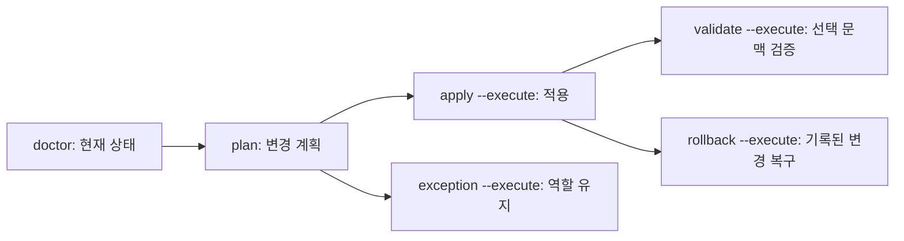

# 진단 CLI 사용법

이 문서는 0.2.1 CLI의 명령과 결과 해석 방법을 설명합니다.
기준일은 2026-11-17입니다.
실제 Windows 호스트와 Codex 앱에서의 확인 상태는 [검증 기록](verification.md)에서 구분합니다.

## 실행 전제조건

Windows 11 x64, Node.js 24 이상과 PowerShell 7을 실행 기준으로 사용합니다.
진단 CLI의 Node.js 요구와 대상 프로젝트의 런타임 요구는 별도로 비교합니다.
소스 체크아웃은 `package-lock.json`에 고정한 의존성을 사용합니다.
설치용 `dist/cli.mjs`에는 실행 의존성 네 개를 포함합니다.
PowerShell 수집기와 정책 자료는 패키지의 함께 배포되는 파일을 사용합니다.
빌드와 로컬 패키지 준비 방법은 [구현 구조](implementation-plan.md)에 기록합니다.

## 명령 선택

명령을 생략하면 `doctor`를 실행합니다.
기본 출력은 한국어 텍스트이며 `--format json`으로 구조화된 결과를 받습니다.

| 명령 | 수행하는 작업 | 실행 조건 |
| --- | --- | --- |
| `doctor` | 정적 분석과 허용한 읽기 전용 조회로 30개 점검 ID를 보고합니다. | 기본 명령입니다. |
| `plan` | 선택한 역할의 차이와 적용 작업을 계획합니다. | 대상 환경을 변경하지 않으며 상태 디렉터리에 계획을 저장합니다. |
| `apply --execute --plan <파일>` | 검토한 계획을 적용합니다. | 계획 파일과 명시적인 실행 요청이 필요합니다. |
| `rollback --execute --journal <ID>` | 해당 저널에서 복구 가능한 자체 파일 변경을 복구합니다. | 기록된 저널 ID와 명시적인 실행 요청이 필요합니다. |
| `exception --execute --role <역할> --reason <이유>` | 해당 프로젝트와 역할의 유지 예외를 저장합니다. | 명시적인 실행 요청이 필요합니다. |
| `validate --execute` | 선택한 문맥의 링크·배포판·엔진·서비스 실행을 검증합니다. | 실행 요청과 구체적인 검증 대상이 필요합니다. |

`doctor`는 도구 설치, 사용자 프로필 변경, 개발 서비스 기동을 수행하지 않습니다.
`plan`은 계획과 상태 기록을 만들지만 설치 작업이나 계획의 파일 변경은 적용하지 않습니다.
설정 적용과 실행 검증은 서로 다른 명령입니다.



## 기본 점검

```powershell
node src/cli.mjs --project .
node src/cli.mjs doctor --project 'C:/src/example' --format json
node src/cli.mjs doctor --project . --languages node,python --native
node src/cli.mjs doctor --project . --wsl --containers --process-compose
node src/cli.mjs --help
node src/cli.mjs --version
```

`--languages`는 `auto` 또는 `node,python,go,rust,zig,dotnet`의 쉼표 목록을 받습니다.
`--native`는 호스트 언어 도구를 사용할 문맥을 명시합니다.
단독 Compose의 DB 서비스는 앱의 컨테이너 실행 근거로 취급하지 않습니다.
유효한 devcontainer와 CI 전용 요구는 호스트 언어의 적용 상태에 별도 근거로 반영합니다.
이 적용 상태는 모든 개발 작업의 실행 위치를 실제로 검증했다는 뜻이 아닙니다.

`doctor`는 상위 버전 선언의 적용 경계와 명시적인 패키지 작업 공간을 분석합니다.
GitHub Actions의 정적 버전 행렬은 로컬 버전 요구와 구분합니다.
Python 가상환경과 Process Compose의 셸·경로·의존·건강 확인·포트는 정적 메타데이터로 기록합니다.
외부 include, 지원하지 않는 동적 표현과 읽기 오류에는 구체적인 미확인 사유를 남깁니다.
소스 코드와 선언에 들어 있는 명령·환경 값을 기본 분석에서 평가하지 않습니다.

## 변경 계획과 적용

`--roles`는 쉼표로 구분한 역할 목록입니다.
`--versions`는 `역할=정확한버전`의 쉼표 목록입니다.
아래 버전은 입력 형식의 예시이며 권장 최신 버전을 뜻하지 않습니다.

```powershell
$state = Join-Path $env:LOCALAPPDATA 'WindowsAgentDevkit/state'
$planFile = Join-Path $state 'review/plan.json'
node src/cli.mjs plan --project 'C:/src/example' --roles runtime-version-manager --versions node=24.10.0 --state-dir $state --format json --output $planFile
node src/cli.mjs apply --project 'C:/src/example' --execute --plan $planFile --state-dir $state --format json
```

지원하는 역할은 `runtime-version-manager`, `powershell-profile`, 여섯 언어와 고정된 도구 이름입니다.
도구 이름은 `mise`, `powershell`, `git`, `vscode`, `docker`, `windows-terminal`, `uv`, `lazydocker`, `process-compose`입니다.
설치 작업은 역할을 선택하고 정확한 버전을 지정한 경우에만 계획합니다.
설치 명령과 패키지 ID는 고정 정책에서 생성합니다.
계획 파일에 임의 명령을 넣어 실행할 수 없습니다.

프로젝트의 런타임 선언, 패키지 관리자, 잠금 파일, 빌드 명령과 CI 선택을 보존합니다.
기존 선언과 충돌하거나 요구를 해석하지 못하면 해당 작업을 보류합니다.
동일한 계획의 재적용은 기존 저널을 사용합니다.
이미 설치된 정확한 버전과 변경이 없는 파일은 중복 적용하지 않습니다.
적용 전에 계획·입력·예외의 해시를 다시 확인합니다.
계획 이후 선언이나 파일이 바뀌면 오래된 계획으로 적용하지 않습니다.

프로필 변경은 `powershell-profile` 역할과 `--profile <절대 경로>`로 선택합니다.
프로필 경로는 저장소와 상태 디렉터리 밖의 `.ps1` 파일이어야 합니다.
관리 블록 적용과 Codex 앱의 새 터미널에서 셸을 실제 선택하는 검증은 구분합니다.

## 상태 기록과 복구

기본 상태 디렉터리는 `LOCALAPPDATA/WindowsAgentDevkit/state`입니다.
데스크톱 앱 등 다른 제품의 상태 기록과 경로를 분리합니다.
`--state-dir`로 저장소 밖의 절대 경로를 지정할 수 있습니다.
직접 지정한 상태 경로에는 `state`를 덧붙이지 않고 해당 경로를 그대로 사용합니다.
계획, 백업, 적용 저널과 유지 예외는 상태 디렉터리에 저장합니다.
보고서에는 원본 파일과 비밀 값을 포함하지 않습니다.

```powershell
node src/cli.mjs rollback --project 'C:/src/example' --execute --journal '<적용 결과의 저널 ID>' --state-dir $state --format json
node src/cli.mjs exception --project 'C:/src/example' --execute --role runtime-version-manager --reason '프로젝트의 기존 관리자를 유지합니다.' --state-dir $state --format json
```

복구는 도구가 기록한 적용 후 해시와 현재 파일이 일치하는 경우에만 수행합니다.
적용 이후의 사용자 편집은 충돌로 남기고 보존합니다.
공유 설치 프로그램과 설치된 도구는 자동 제거하지 않습니다.
이 경우 저널은 수동 복구가 필요한 범위를 구분합니다.
유지 예외는 정규화한 프로젝트 경로와 역할에 적용됩니다.
유지 이유와 범위를 다음 계획에 반영합니다.

## 선택한 문맥의 실행 검증

```powershell
node src/cli.mjs validate --project 'C:/src/example' --execute --distro Ubuntu-24.04 --linux-cwd /home/me/src/example --linux-tools bash --format json
node src/cli.mjs validate --project 'C:/src/example' --execute --docker-context desktop-linux --image alpine:3.22 --format json
node src/cli.mjs validate --project 'C:/src/example' --execute --docker-context desktop-linux --compose-file compose.yaml --services api --format json
node src/cli.mjs validate --project 'C:/src/example' --execute --service-config process-compose.yaml --services api --format json
```

WSL 검증은 배포판과 Linux 절대 작업 경로를 함께 선택합니다.
`--linux-tools <쉼표 목록>`으로 배포판 안에서 확인할 도구를 선택할 수 있습니다.
지원하는 이름은 `bash`, `mise`, `node`, `python3`, `go`, `rustc`, `zig`, `dotnet`입니다.
생략하면 bash·mise와 적용되는 프로젝트 언어 도구를 선택합니다.
`--linux-tools bash`는 도구 조회 범위를 bash로 한정합니다.
이 옵션은 언어 도구의 설치 요청이 아닙니다.
Windows 실행 파일과 Linux 도구의 경로를 구분합니다.
Docker 검증은 context의 연결 대상과 서버 OS·아키텍처를 구분합니다.
이미지 검증은 로컬에 있는 이미지를 사용하며 자동 pull을 수행하지 않습니다.
Compose 검증은 선택한 서비스와 자체 프로젝트 식별자로 범위를 한정합니다.
Process Compose 검증은 선택한 설정과 서비스의 시작·준비 상태·종료를 구분합니다.
준비 검사가 없는 서비스는 실행 중이라는 이유만으로 준비 완료로 판정하지 않습니다.
Rust 검증은 선택한 target에 임시 소스를 링크해 산출물을 확인합니다.
기존 서비스·이미지·볼륨·프로세스는 정리 대상으로 삼지 않습니다.

`--task-file <파일>`은 명시적으로 선택한 개발 작업을 전달합니다.
호스트 작업은 `context: "native"`, `trusted: true`, 도구 이름과 문자열 인수 배열을 사용합니다.
허용한 호스트 도구는 `node`, `npm`, `python`, `uv`, `go`, `cargo`, `rustc`, `zig`, `dotnet`, `pwsh`입니다.
아래는 대상 프로젝트가 이미 `npm test`를 사용하는 경우의 `task.json` 예시입니다.

```json
{
  "context": "native",
  "tool": "npm",
  "args": ["test"],
  "trusted": true
}
```

```powershell
node src/cli.mjs validate --project 'C:/src/example' --execute --task-file task.json --format json
```

호스트 작업은 대상 프로젝트의 작업 경로에서 실행합니다.
`context: "rust"`와 `context: "wsl"`은 해당 문맥의 실행 검증에서 사용합니다.
작업의 문맥과 명령은 실행 전에 검토해야 합니다.
작업 파일은 기본 `doctor`에서 실행하지 않습니다.
호스트 작업의 `status`와 `exitCode`는 별도 `task` 필드에 기록합니다.
원시 표준 출력과 표준 오류는 작업 보고서에 포함하지 않습니다.
실제 호스트에서의 기동과 프로젝트 작업 성공 여부는 실행 결과로 별도 확인해야 합니다.

## 옵션

| 옵션 | 의미 |
| --- | --- |
| `--project <경로>` | 대상 프로젝트를 선택합니다. |
| `--format <text\|json>` | 결과 형식을 선택합니다. |
| `--languages <목록>`, `--native` | 호스트 언어 점검 문맥을 선택합니다. |
| `--wsl`, `--containers`, `--process-compose` | 해당 호스트 도구와 정적 설정 점검을 요청합니다. |
| `--roles <목록>`, `--versions <역할=버전,...>` | 계획할 역할과 정확한 버전을 선택합니다. |
| `--profile <경로>`, `--state-dir <경로>` | 프로필 대상과 저장소 밖 상태 경로를 선택합니다. |
| `--plan <파일>`, `--journal <ID>` | 적용 계획과 복구 저널을 선택합니다. |
| `--role <역할>`, `--reason <이유>`, `--scope <범위>` | 유지 예외의 역할·이유·범위를 지정하며 기본 범위는 `project`입니다. |
| `--execute` | 적용·예외 저장·실행 검증을 명시적으로 요청합니다. |
| `--distro <이름>`, `--linux-cwd <경로>` | WSL 배포판과 Linux 작업 경로를 선택합니다. |
| `--linux-tools <목록>` | WSL에서 확인할 Linux 도구를 쉼표 목록으로 선택합니다. |
| `--docker-context <이름>`, `--image <참조>` | Docker 검증 문맥과 로컬 이미지를 선택합니다. |
| `--image-readiness <exit\|running\|healthy>` | 로컬 이미지 검증의 준비 판정 방식을 선택합니다. |
| `--compose-file <파일>`, `--services <목록>` | Compose 설정과 서비스 목록을 선택합니다. |
| `--service-config <파일>` | Process Compose 설정을 선택합니다. |
| `--rust-targets <목록>` | 검사할 설치된 Rust target을 쉼표 목록으로 선택합니다. |
| `--task-file <파일>` | 선택한 문맥에서 실행할 작업을 전달합니다. |
| `--app`, `--ide`, `--github-auth` | 앱·IDE·GitHub 인증의 선택적 점검을 요청합니다. |
| `--storage <경로>` | 조회할 볼륨의 경로를 선택합니다. |
| `--codex-executable <경로>` | 앱 설치 목록 조회에 사용할 Codex 네이티브 실행 파일을 명시합니다. |
| `--timeout-ms <정수>` | 개별 조회의 제한 시간을 지정합니다. |
| `--output <파일>` | 결과를 저장하며 기존 파일을 덮어쓰지 않습니다. |
| `--help`, `--version` | 도움말과 CLI 버전을 표시합니다. |

`--timeout-ms`는 기본값이 5000이며 100..30000 범위의 정수를 받습니다.
옵션의 허용 조합은 실행 중인 버전의 `--help`를 기준으로 확인합니다.
`--storage <경로>`는 선택 경로의 파일 시스템과 Dev Drive 지정 여부를 구분합니다.
`--app`과 `--ide`의 메타데이터 조회는 실제 앱 로딩과 새 터미널 검증을 대신하지 않습니다.
`--github-auth`는 인증 조회를 명시적으로 요청하며 인증 값은 보고서에 포함하지 않습니다.

## 결과 해석

`doctor` 보고서는 기존 P0 22개와 P1 8개를 합친 30개 점검 ID를 사용합니다.
실행 검증을 요청하지 않은 항목은 생략 또는 미확인으로 남습니다.
`validate`도 30개 점검 보고서에 선택한 실행의 `validation` 근거와 별도 `task` 결과를 포함합니다.
모든 점검 ID가 연결되었다는 사실은 모든 호스트 검증이 완료되었다는 뜻이 아닙니다.

| 상태 | 의미 |
| --- | --- |
| `pass` | 명시한 확인 범위에서 요구를 충족했습니다. |
| `fail` | 실행 실패나 확인한 요구 위반이 있습니다. |
| `warn` | 권장 차이·지원 종료·검토할 선언이 있습니다. |
| `unknown` | 해석·조회·지원 근거가 부족합니다. |
| `skipped` | 해당 요구나 실행 요청이 없습니다. |

`resolution`, `execution`, `compatibility`, `support`, `recommendation`은 서로 다른 판단입니다.
기본 조회는 PE 형식과 실행 경로를 확인한 실행 파일에 허용된 읽기 전용 인수를 전달합니다.
검증하지 못한 wrapper·proxy·shim은 실행을 보류합니다.
명령 후보를 찾지 못했다는 관찰을 컴퓨터 전체의 미설치로 일반화하지 않습니다.

공식 지원 판정은 2026-11-17에 확인한 오프라인 정책 스냅샷을 사용합니다.
스냅샷의 유효기간은 30일이며 만료일은 2026-12-17입니다.
기준일보다 이전이거나 만료일을 지난 실행은 정책을 최신으로 단정하지 않고 `unknown`으로 남깁니다.
릴리스 계열의 지원 판정은 패치 최신성·취약점 상태·모든 플랫폼의 지원을 보장하지 않습니다.
공식 정책을 수록하지 않은 도구와 판정할 수 없는 버전도 미확인으로 남깁니다.

| 종료 코드 | 의미 |
| --- | --- |
| 0 | 확인한 실패 없이 결과를 생성했습니다. |
| 1 | 보고된 실패나 요구 위반이 있습니다. |
| 2 | 옵션·입력·실행 전제조건 등의 오류가 있습니다. |

## 개발 검사

```powershell
node --test
node scripts/check-package.mjs
```

테스트는 임시 프로젝트와 주입한 조회 결과로 분석·판정·적용·복구의 동작을 검사합니다.
문서 링크와 패키지 검사는 실제 Windows 호스트의 전체 검증을 대신하지 않습니다.
실제 호스트와 앱에서 확인한 범위는 아래 표로 구분합니다.

## 현재 확인한 실행 결과

2026-11-17에 전달된 통합 검증 결과를 기준으로 기록합니다.
현재 패키지와 소스 버전은 0.2.1입니다.
앱의 최초 설치·발견·실제 호출을 확인한 버전은 0.2.0입니다.
최신 0.2.1의 실제 앱 재호출을 완료했습니다.
일반 샌드박스의 `use_default` 첫 실행에서 종료 코드 0을 확인했습니다.
권한 상승은 요청하지 않았습니다.

| 대상 | 확인한 결과 | 남은 검증과 범위 |
| --- | --- | --- |
| Windows `doctor` | 실제 호스트에서 30개 ID의 보고서를 생성했습니다. | 30개 항목이 모두 통과했다는 의미는 아닙니다. |
| Node.js·Python | 실제 실행과 버전 확인에 성공했습니다. | 모든 프로젝트 명령의 성공을 보장하지 않습니다. |
| Go | PE 실행 파일의 내장 버전 확인에 성공했습니다. | Go 명령을 실행한 버전 조회와는 다른 근거입니다. |
| 계획·적용·복구 | 통제된 임시 프로젝트에서 plan preview·apply·재적용·rollback·exception이 통과했습니다. | 실제 사용자 프로필과 공유 설치 전체의 검증으로 확대하지 않습니다. |
| 호스트 개발 작업 | 통제된 임시 npm 프로젝트의 작업이 실제 실행에서 통과했습니다. | 임의 프로젝트의 전체 빌드·테스트 성공과 구분합니다. |
| 로컬 플러그인 | 최신 앱 호출의 `CODEX-01: pass`에서 설치·활성과 버전 0.2.1을 확인했습니다. | 새 터미널의 수동 설정 선택은 별도 검증입니다. |
| 앱의 기능 발견과 실제 호출 | Skill 세 개 발견과 최초 0.2.0 호출 이후 최신 0.2.1의 실제 재호출을 완료했습니다. | 일반 샌드박스의 첫 실행에서 권한 상승 없이 종료 코드 0을 확인했습니다. |
| Process Compose | Windows Job helper로 실제 서비스의 start·readiness·stop이 모두 통과했습니다. | 정리 근거는 `forced: false`, `proof: windows_job_empty`입니다. |
| WSL 내부 | 기존 Ubuntu-24.04에서 지정 경로와 bash 고정 조회로 `WSL-02: pass`를 확인했습니다. | 전체 언어 도구 설치와 프로젝트 개발 명령 실행은 이 결과에 포함하지 않습니다. |
| Docker 엔진 | CI와 모의 조회로 동작 경로를 검사했습니다. | 검증할 호스트가 없어 실제 엔진 실행은 미확인입니다. |

앱 화면 스크린샷은 추적하지 않는 `.local/`에 보관합니다.
Process Compose 정리 근거는 선택한 실서비스와 해당 실행에서 확인한 결과입니다.
최신 앱 보고서에는 checkId 30개가 있으며 고유 ID도 30개입니다.
집계는 `pass: 11`, `fail: 0`, `warn: 0`, `unknown: 4`, `skipped: 15`입니다.
메타데이터 출처는 `context.metadataSource: local-process-and-registry`입니다.
이 집계는 해당 실행의 관찰이며 다른 PC의 기대값으로 고정하지 않습니다.
새 터미널의 수동 설정 선택과 셸·프로필 적용은 별도 확인이 남아 있습니다.
0.2.1에는 CIM 접근 실패 시 로컬 프로세스·레지스트리 메타데이터를 읽는 대체 경로를 반영했습니다.
일반 샌드박스의 최신 앱 재호출에서 이 대체 경로의 사용을 확인했습니다.
전달된 소스 테스트 결과는 총 264개 중 통과 261개·실패 0개·생략 3개입니다.

WSL 실측은 아래 명령의 선택 범위에 해당합니다.

```powershell
node src/cli.mjs validate --project 'F:/workspace/project/tttaliesin/windows-agent-devkit' --execute --distro Ubuntu-24.04 --linux-cwd /mnt/f/workspace/project/tttaliesin/windows-agent-devkit --linux-tools bash --format json
```

관찰한 OS와 아키텍처는 Linux와 `x86_64`입니다.
셸은 `/usr/bin/sh`이며 bash는 `/usr/bin/bash`의 5.2.21입니다.
이미 존재하는 배포판 안에서 고정된 조회만 실행했습니다.
이 검증을 위해 여섯 언어의 WSL 환경을 설치하지 않았습니다.

## 0.1 구현 이력

0.1.0은 P0 22개 ID의 제한된 정적 분석과 로컬 조회를 제공했습니다.
당시에는 상위 선언·작업 공간·CI의 의미 분석과 설정 적용을 구현하지 않았습니다.
P1 8개 ID와 실제 서비스 실행 검증도 후속 범위로 남겼습니다.
이 설명은 이전 구현 이력이며 현재 기능의 기준은 위의 0.2.1 계약입니다.
