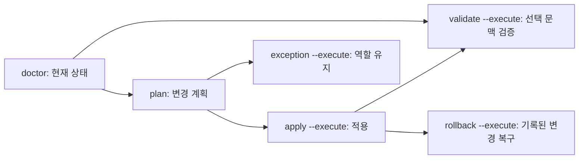

# 진단 CLI 사용법

이 문서는 설치한 CLI로 환경을 진단하고 선택한 작업을 검증하거나 등록하는 방법을 설명합니다.
배포 버전과 실제 Windows 호스트·Codex 앱 검증 결과는 [검증 기록](verification.md)에서 확인합니다.

## 실행 전제조건

Windows 11 x64, Node.js 24 이상과 PowerShell 7을 실행 기준으로 사용합니다.
진단 CLI의 Node.js 요구와 대상 프로젝트의 런타임 요구는 별도로 비교합니다.
먼저 플러그인을 설치하고 점검할 프로젝트 디렉터리를 준비합니다. [로컬 설치 절차](../README.md#로컬-플러그인-설치)
`$pluginRoot`에는 설치본의 `skills/environment-doctor/SKILL.md`가 있는 디렉터리에서 두 단계 위의 실제 절대 경로를 넣습니다.
`$projectRoot`에는 이미 존재하는 대상 프로젝트의 절대 경로를 넣습니다.
아래 CLI 예시는 모두 같은 설치본의 `dist/cli.mjs`를 호출합니다.
설치본은 번들에 포함한 의존성과 함께 배포된 PowerShell 파일·정책 자료를 사용합니다.

```powershell
$pluginRoot = 'C:/path/to/installed/windows-agent-devkit'
$projectRoot = 'C:/src/example'
$cli = Join-Path $pluginRoot 'dist/cli.mjs'
```

## 명령 선택

명령을 생략하면 `doctor`를 실행합니다.
기본 출력은 한국어 텍스트이며 `--format json`으로 구조화된 결과를 받습니다.

| 명령 | 수행하는 작업 | 실행 조건 |
| --- | --- | --- |
| `doctor` | 정적 분석과 허용한 읽기 전용 조회로 30개 점검 ID를 보고합니다. | 기본 명령입니다. |
| `plan` | 선택한 역할의 차이와 적용 작업을 계획합니다. | 대상 환경을 변경하지 않으며 상태 디렉터리에 계획을 저장합니다. |
| `apply --execute --plan <파일>` | 검토한 계획을 적용합니다. | 계획 파일과 명시적인 실행 요청이 필요합니다. |
| `rollback --execute --journal <ID>` | 해당 저널에서 복구 가능한 자체 파일 변경을 복구합니다. | 기록된 저널 ID와 명시적인 실행 요청이 필요합니다. |
| `exception --execute --role <역할> --reason <이유>` | 해당 프로젝트와 역할의 유지 예외를 저장합니다. | 명시적인 실행 요청이 필요합니다. |
| `validate --execute` | 선택한 문맥의 링크·배포판·엔진·서비스 또는 개발 작업을 검증합니다. | 실행 요청과 구체적인 검증 대상이 필요합니다. |
| `wsl-register` | 선택한 WSL 작업의 등록 입력을 읽기 전용으로 검토하고 확인 지문을 출력합니다. | 0.3.2에서 등록 ID, 배포판, Linux 작업 경로, 작업 JSON을 지정합니다. |
| `wsl-register --execute --confirm <지문>` | 검토한 입력에 결합된 작업을 등록합니다. | 같은 입력과 검토에서 반환한 지문이 필요합니다. |
| `wsl-tasks` | 선택한 Windows 프로젝트의 등록 작업과 전용 실행 경로를 표시합니다. | 0.3.2의 읽기 전용 조회입니다. |
| `wsl-unregister --task-name <ID> --execute` | 해당 프로젝트의 등록을 철회하고 기존 전용 실행 경로를 봉인합니다. | 0.3.2에서 등록 ID와 명시적인 실행 요청이 필요합니다. |

실행 대상을 선택하지 않았거나 메타데이터만 확인하려면 `doctor`를 사용합니다.
`doctor`는 도구 설치, 사용자 프로필 변경, 개발 서비스 기동을 수행하지 않습니다.
`plan`은 계획과 상태 기록을 만들지만 설치 작업이나 계획의 파일 변경은 적용하지 않습니다.
설정 적용과 실행 검증은 서로 다른 명령입니다.



## 기본 점검

```powershell
node $cli --project $projectRoot
node $cli doctor --project $projectRoot --format json
node $cli doctor --project $projectRoot --languages node,python --native
node $cli doctor --project $projectRoot --wsl --containers --process-compose
node $cli doctor --project $projectRoot --app --format json
node $cli --help
node $cli --version
```

`--languages`는 `auto` 또는 `node,python,go,rust,zig,dotnet`의 쉼표 목록을 받습니다.
`--native`는 호스트 언어 도구를 사용할 문맥을 명시합니다.
단독 Compose의 DB 서비스는 앱의 컨테이너 실행 근거로 취급하지 않습니다.
유효한 devcontainer와 CI 전용 요구는 호스트 언어의 적용 상태에 별도 근거로 반영합니다.
이 적용 상태는 모든 개발 작업의 실행 위치를 실제로 검증했다는 뜻이 아닙니다.

`doctor`는 상위 버전 선언의 적용 경계와 명시적인 패키지 작업 공간을 분석합니다.
GitHub Actions의 정적 버전 행렬은 로컬 버전 요구와 구분합니다.
Python 가상환경과 Process Compose의 셸·경로·의존·건강 확인·포트는 정적 메타데이터로 기록합니다.
외부 include, 지원하지 않는 동적 표현과 읽기 오류에는 구체적인 미확인 사유를 남깁니다.
소스 코드와 선언에 들어 있는 명령·환경 값을 기본 분석에서 평가하지 않습니다.

작업 실행기는 mise tasks·Taskfile·Justfile·Makefile과 기존 npm scripts의 선언을 정적으로 탐지합니다.
includes·import·동적 변수·템플릿 등 지원하지 않는 문법은 `unknown`으로 남깁니다.
파일이나 작업 이름의 발견은 해당 작업의 실행 성공을 뜻하지 않습니다.
목록 조회와 dry run도 설정을 평가할 수 있으므로 자동 실행하지 않습니다.
정적 탐지의 한계와 선택 기준은 [작업 실행기 가이드](task-runners.md)에 기록합니다.

## 변경 계획과 적용

`--roles`는 쉼표로 구분한 역할 목록입니다.
`--versions`는 `역할=정확한버전`의 쉼표 목록입니다.
아래 버전은 입력 형식의 예시입니다.
`$planFile`에는 새 계획을 저장할 파일 경로를 지정합니다.

```powershell
$state = Join-Path $env:LOCALAPPDATA 'WindowsAgentDevkit/state'
$planFile = Join-Path $state 'review/plan.json'
node $cli plan --project $projectRoot --roles runtime-version-manager --versions node=24.10.0 --state-dir $state --format json --output $planFile
```

저장한 계획에서 적용할 작업을 확인한 뒤 실행합니다.

```powershell
node $cli apply --project $projectRoot --execute --plan $planFile --state-dir $state --format json
```

지원하는 역할은 `runtime-version-manager`, `powershell-profile`, 여섯 언어와 고정된 도구 이름입니다.
도구 이름은 `mise`, `powershell`, `git`, `vscode`, `docker`, `windows-terminal`, `uv`, `lazydocker`, `process-compose`입니다.
설치 작업은 역할을 선택하고 정확한 버전을 지정한 경우에만 계획합니다.
설치 명령과 패키지 ID는 고정 정책에서 생성합니다.
계획 파일에 임의 명령을 넣어 실행할 수 없습니다.

프로젝트의 런타임 선언, 패키지 관리자, 잠금 파일, 빌드 명령과 CI 선택을 보존합니다.
기존 선언과 충돌하거나 요구를 해석하지 못하면 해당 작업을 보류합니다.
동일한 계획의 재적용은 기존 저널을 사용합니다.
이미 설치된 정확한 버전과 변경이 없는 파일은 중복 적용하지 않습니다.
적용 전에 계획·입력·예외의 해시를 다시 확인합니다.
계획 이후 선언이나 파일이 바뀌면 오래된 계획으로 적용하지 않습니다.

프로필 변경은 `powershell-profile` 역할과 `--profile <절대 경로>`로 선택합니다.
프로필 경로는 저장소와 상태 디렉터리 밖의 `.ps1` 파일이어야 합니다.
관리 블록 적용과 Codex 앱의 새 터미널에서 셸을 실제 선택하는 검증은 구분합니다.

## 상태 기록과 복구

기본 상태 디렉터리는 `LOCALAPPDATA/WindowsAgentDevkit/state`입니다.
데스크톱 앱 등 다른 제품의 상태 기록과 경로를 분리합니다.
`--state-dir`로 저장소 밖의 절대 경로를 지정할 수 있습니다.
직접 지정한 상태 경로에는 `state`를 덧붙이지 않고 해당 경로를 그대로 사용합니다.
계획, 백업, 적용 저널과 유지 예외는 상태 디렉터리에 저장합니다.
보고서에는 원본 파일과 비밀 값을 포함하지 않습니다.

```powershell
node $cli rollback --project $projectRoot --execute --journal '<적용 결과의 저널 ID>' --state-dir $state --format json
node $cli exception --project $projectRoot --execute --role runtime-version-manager --reason '프로젝트의 기존 관리자를 유지합니다.' --state-dir $state --format json
```

복구는 도구가 기록한 적용 후 해시와 현재 파일이 일치하는 경우에만 수행합니다.
적용 이후의 사용자 편집은 충돌로 남기고 보존합니다.
공유 설치 프로그램과 설치된 도구는 자동 제거하지 않습니다.
이 경우 저널은 수동 복구가 필요한 범위를 구분합니다.
유지 예외는 정규화한 프로젝트 경로와 역할에 적용됩니다.
유지 이유와 범위를 다음 계획에 반영합니다.

## 선택한 문맥의 실행 검증

```powershell
node $cli validate --project $projectRoot --execute --rust-targets x86_64-pc-windows-msvc --format json
node $cli validate --project $projectRoot --execute --distro Ubuntu-24.04 --linux-cwd /home/me/src/example --linux-tools bash --format json
node $cli validate --project $projectRoot --execute --docker-context desktop-linux --image alpine:3.22 --format json
node $cli validate --project $projectRoot --execute --docker-context desktop-linux --compose-file compose.yaml --services api --format json
node $cli validate --project $projectRoot --execute --service-config process-compose.yaml --services api --format json
```

각 예시의 target·배포판·경로·이미지·설정은 실제로 준비된 검증 대상으로 바꿉니다.
Rust는 `--rust-targets` 또는 작업 JSON의 `context: "rust"`를 명시한 경우에만 링크 검증을 실행합니다.
링크 검증은 선택한 target에 임시 소스를 링크해 산출물을 확인합니다.
WSL 검증에는 기존 배포판 이름과 배포판 내부에 이미 존재하는 Linux 절대 작업 경로를 지정합니다.
`--linux-tools <쉼표 목록>`으로 배포판 안에서 확인할 도구를 선택할 수 있습니다.
지원하는 이름은 `bash`, `mise`, `node`, `python3`, `go`, `rustc`, `zig`, `dotnet`입니다.
생략하면 bash·mise와 적용되는 프로젝트 언어 도구를 선택합니다.
`--linux-tools bash`는 도구 조회 범위를 bash로 한정합니다.
이 옵션은 언어 도구의 설치 요청이 아닙니다.
Windows 실행 파일과 Linux 도구의 경로를 구분합니다.
Docker 검증은 context의 연결 대상과 서버 OS·아키텍처를 구분합니다.
이미지 검증은 로컬에 있는 이미지를 사용하며 자동 pull을 수행하지 않습니다.
Compose 검증은 선택한 서비스와 자체 프로젝트 식별자로 범위를 한정합니다.
Process Compose 검증은 선택한 설정과 서비스의 시작·준비 상태·종료를 구분합니다.
준비 검사가 없는 서비스는 실행 중이라는 이유만으로 준비 완료로 판정하지 않습니다.
기존 서비스·이미지·볼륨·프로세스는 정리 대상으로 삼지 않습니다.

`--task-file <파일>`은 명시적으로 선택한 개발 작업을 플러그인 JSON으로 전달합니다.
Go Task의 Taskfile YAML을 전달하는 옵션이 아닙니다.
호스트 작업은 `context: "native"`, `trusted: true`, 도구 이름과 문자열 인수 배열을 사용합니다.
기존 호스트 도구는 `node`, `npm`, `python`, `uv`, `go`, `cargo`, `rustc`, `zig`, `dotnet`, `pwsh`입니다.
`mise`, `task`, `just`, `make`도 선택 실행기로 사용할 수 있습니다.
아래는 대상 프로젝트에 선언된 mise의 `check` 작업을 선택하는 `task.json` 예시입니다.

```json
{
  "context": "native",
  "tool": "mise",
  "args": ["run", "check"],
  "trusted": true,
  "cwd": ".",
  "env": {}
}
```

검토한 JSON을 `$projectRoot/task.json`에 저장하거나 아래의 `$taskFile`에 실제 파일 경로를 넣습니다.

```powershell
$taskFile = Join-Path $projectRoot 'task.json'
node $cli validate --project $projectRoot --execute --task-file $taskFile --format json
```

| 선택한 기존 명령 | JSON의 `tool` | JSON의 `args` |
| --- | --- | --- |
| `mise run check` | `mise` | `["run", "check"]` |
| `task check` | `task` | `["check"]` |
| `just check` | `just` | `["check"]` |
| `make check` | `make` | `["check"]` |
| `npm test` | `npm` | `["test"]` |

실제 프로젝트에 선언된 작업 이름과 인수를 선택합니다.
설정 구문은 최신 공식 문서와 실제 실행기 버전의 지원 범위를 대조합니다.
`native`의 `cwd`를 생략하면 대상 프로젝트의 루트에서 실행합니다.
`native`의 `cwd`에는 프로젝트 내부의 상대 경로나 절대 경로를 지정할 수 있습니다.
`native`의 `env`는 자식 작업에 전달할 환경 변수 이름과 문자열 값의 객체입니다.
환경 값과 비밀 값은 보고서에 기록하지 않습니다.
도구와 인수는 셸 문자열로 합성하지 않습니다.
작업의 문맥과 명령은 실행 전에 검토해야 합니다.
원시 표준 출력과 표준 오류는 작업 보고서에 포함하지 않습니다.

Rust와 WSL의 선택 작업은 각각 `context: "rust"` 또는 `context: "wsl"`과 `trusted: true`를 지정합니다.
각 작업은 실행할 `tool`과 문자열 `args` 배열을 사용합니다.
WSL 작업은 `tool`에 선택한 배포판의 Linux 절대 실행 경로를 넣습니다.
WSL 작업 호출에는 배포판과 Linux 작업 경로를 지정하고 `--task-file`을 함께 전달합니다.
Rust와 WSL 작업은 해당 문맥의 선행 검증을 통과하면 실행합니다.
WSL 검증의 선행 단계에서 중단되어 선택 작업이 실행되지 않은 경우에도 `validate --execute`는 종료 코드 1을 반환합니다.
`context`에 `native`, `rust`, `wsl` 이외의 값을 넣으면 입력 오류로 종료 코드 2를 반환합니다.

플러그인 경유 mise 작업은 도구 자동 설치를 비활성화합니다.
mise의 일반 기본값은 필요한 도구를 자동 설치할 수 있으므로 플러그인의 실행 제한과 구분합니다. [mise 설정](https://mise.jdx.dev/configuration/settings.html)
`trusted: true`는 선택한 작업을 실행하겠다는 플러그인 입력입니다.
플러그인은 별도의 `mise trust` 명령이나 신뢰 경로 확장을 추가하지 않습니다.
mise 자체의 암묵적 신뢰 처리는 설치한 버전과 paranoid 설정을 따릅니다.
설정 신뢰가 필요한 모드에서 실행이 거부되면 실패 결과를 그대로 보고합니다.
Windows Job 실행은 원시 출력을 수집하지 않으므로 종료 코드만으로 실패 원인을 확정하지 않습니다.
공유 mise 상태 경로가 샌드박스의 쓰기 범위 밖이면 작업 JSON의 `env.MISE_STATE_DIR`로 선택한 작업용 상태 경로를 지정할 수 있습니다.
기존 상태 경로의 신뢰 기록은 새 경로로 자동 복사하지 않습니다.
이 항목의 공식 자료 확인일은 2026-11-17입니다.
셸 기본값·의존 작업·서비스 호출의 검토 방법은 [작업 실행기 가이드](task-runners.md)를 따릅니다.

## 승인한 WSL 작업 등록

반복 실행할 작업을 사용자가 선택한 경우 `wsl-register`를 사용합니다.
`--project`는 규칙을 두고 전용 `.exe`를 호출할 Windows 프로젝트의 절대 경로입니다.
`--linux-cwd`는 선택한 배포판의 네이티브 Linux 파일 시스템에 있는 실제 작업 디렉터리입니다.
등록용 작업 JSON에는 `context: "wsl"`, `trusted: true`, Linux 실행 파일의 절대 경로인 `tool`과 순서가 있는 문자열 배열인 `args` 네 필드만 지정합니다.
읽기 전용 검토의 `confirmation` 값은 확인한 입력 그대로 등록할 때 `--confirm`으로 전달합니다.
인수 원문과 순서는 작업 JSON에서 확인합니다.
`wsl-tasks`에 표시된 전용 `.exe`는 같은 Windows 작업 디렉터리에서 인수 없이 직접 호출합니다.
설치본과 앱의 확인 상태를 포함한 전체 절차는 [승인한 WSL 작업 등록 가이드](wsl-task-registration.md)에서 확인합니다.

## 옵션

| 옵션 | 의미 |
| --- | --- |
| `--project <경로>` | 대상 프로젝트를 선택합니다. |
| `--format <text\|json>` | 결과 형식을 선택합니다. |
| `--languages <목록>`, `--native` | 호스트 언어 점검 문맥을 선택합니다. |
| `--wsl`, `--containers`, `--process-compose` | 해당 호스트 도구와 정적 설정 점검을 요청합니다. |
| `--roles <목록>`, `--versions <역할=버전,...>` | 계획할 역할과 정확한 버전을 선택합니다. |
| `--profile <경로>`, `--state-dir <경로>` | 프로필 대상과 저장소 밖 상태 경로를 선택합니다. |
| `--plan <파일>`, `--journal <ID>` | 적용 계획과 복구 저널을 선택합니다. |
| `--role <역할>`, `--reason <이유>`, `--scope <범위>` | 유지 예외의 역할·이유·범위를 지정하며 기본 범위는 `project`입니다. |
| `--execute` | 적용·예외 저장·실행 검증·WSL 작업 등록 및 철회를 명시적으로 요청합니다. |
| `--distro <이름>`, `--linux-cwd <경로>` | WSL 배포판과 Linux 작업 경로를 선택합니다. |
| `--linux-tools <목록>` | WSL에서 확인할 Linux 도구를 쉼표 목록으로 선택합니다. |
| `--task-name <ID>` | `wsl-register`와 `wsl-unregister`에서 프로젝트 내 등록 ID를 지정합니다. |
| `--confirm <지문>` | 읽기 전용 검토가 반환한 확인 지문을 `wsl-register --execute`에 전달합니다. |
| `--docker-context <이름>`, `--image <참조>` | Docker 검증 문맥과 로컬 이미지를 선택합니다. |
| `--image-readiness <exit\|running\|healthy>` | 로컬 이미지 검증의 준비 판정 방식을 선택합니다. |
| `--compose-file <파일>`, `--services <목록>` | Compose 설정과 서비스 목록을 선택합니다. |
| `--service-config <파일>` | Process Compose 설정을 선택합니다. |
| `--rust-targets <목록>` | 검사할 설치된 Rust target을 쉼표 목록으로 선택합니다. |
| `--task-file <파일>` | 선택한 문맥의 작업을 플러그인 JSON으로 전달하며 Go Task의 Taskfile은 받지 않습니다. |
| `--app`, `--ide`, `--github-auth` | 앱·IDE·GitHub 인증의 선택적 점검을 요청합니다. |
| `--storage <경로>` | 조회할 볼륨의 경로를 선택합니다. |
| `--codex-executable <경로>` | 앱 설치 목록 조회에 사용할 Codex 네이티브 실행 파일을 명시합니다. |
| `--timeout-ms <정수>` | 개별 조회의 제한 시간을 지정합니다. |
| `--output <파일>` | 결과를 저장하며 기존 파일을 덮어쓰지 않습니다. |
| `--help`, `--version` | 도움말과 CLI 버전을 표시합니다. |

`--timeout-ms`는 기본값이 5000이며 100..30000 범위의 정수를 받습니다.
WSL 등록 명령에는 각 명령의 전용 옵션과 `--project`, `--format`, `--help`, `--version`을 사용할 수 있습니다.
옵션의 허용 조합은 실행 중인 버전의 `--help`를 기준으로 확인합니다.
`--storage <경로>`는 선택 경로의 파일 시스템과 Dev Drive 지정 여부를 구분합니다.
`--app`과 `--ide`의 메타데이터 조회는 실제 앱 로딩과 새 터미널 검증을 대신하지 않습니다.
`--github-auth`는 인증 조회를 명시적으로 요청하며 인증 값은 보고서에 포함하지 않습니다.

## 결과 해석

`doctor` 보고서는 기존 P0 22개와 P1 8개를 합친 30개 점검 ID를 사용합니다.
실행 검증을 요청하지 않은 항목은 생략 또는 미확인으로 남습니다.
`validate`도 같은 30개 점검 ID로 보고서를 생성합니다.
`native` 선택 작업의 상태와 종료 코드는 `report.task`에서 확인합니다.
Rust 선택 작업의 증거는 `report.validation["RUST-02"].steps`의 `task` 단계에서 확인합니다.
WSL 선택 작업의 증거는 `report.validation["WSL-02"].steps`의 `task` 단계에서 확인합니다.
`doctor`나 실행 전 검토에서 선택하지 않은 대상의 `skipped`는 정상입니다.
실행기의 셸·작업 경로·도구 경로·정적 요구·권장 차이는 SH-01·ENV-02·PATH-01·REQ-01·RCM-01에 연결합니다.
실행기용 check ID나 필수 hook을 추가하지 않습니다.
모든 점검 ID가 연결되었다는 사실은 모든 호스트 검증이 완료되었다는 뜻이 아닙니다.

| 상태 | 의미 |
| --- | --- |
| `pass` | 명시한 확인 범위에서 요구를 충족했습니다. |
| `fail` | 실행 실패나 확인한 요구 위반이 있습니다. |
| `warn` | 권장 차이·지원 종료·검토할 선언이 있습니다. |
| `unknown` | 해석·조회·지원 근거가 부족합니다. |
| `skipped` | 해당 요구나 실행 요청이 없습니다. |

`resolution`, `execution`, `compatibility`, `support`, `recommendation`은 서로 다른 판단입니다.
기본 조회는 PE 형식과 실행 경로를 확인한 실행 파일에 허용된 읽기 전용 인수를 전달합니다.
검증하지 못한 wrapper·proxy·shim은 실행을 보류합니다.
명령 후보를 찾지 못했다는 관찰을 컴퓨터 전체의 미설치로 일반화하지 않습니다.

공식 지원 판정은 2026-11-17에 확인한 오프라인 정책 스냅샷을 사용합니다.
스냅샷의 유효기간은 30일이며 만료일은 2026-12-17입니다.
기준일보다 이전이거나 만료일을 지난 실행은 정책을 최신으로 단정하지 않고 `unknown`으로 남깁니다.
릴리스 계열의 지원 판정은 패치 최신성·취약점 상태·모든 플랫폼의 지원을 보장하지 않습니다.
공식 정책을 수록하지 않은 도구와 판정할 수 없는 버전도 미확인으로 남깁니다.

| 종료 코드 | 의미 |
| --- | --- |
| 0 | 확인한 실패 없이 결과를 생성했습니다. |
| 1 | 실패·요구 위반이 있거나 `validate --execute`에서 명시적으로 선택한 검증 항목이 `unknown` 또는 `skipped`입니다. |
| 2 | 옵션·입력·실행 전제조건 등의 오류가 있습니다. |

## 개발 검사

소스 체크아웃에서 CLI를 개발하는 경우에는 저장소 루트에서 빌드한 뒤 소스 검사와 패키지 생성을 실행합니다. [개발 절차](implementation-plan.md#빌드와-패키지)
0.2.1 및 이전 버전의 소스·실제 실행 결과는 과거 검증 이력에서 확인합니다. [검증 기록](verification.md)
