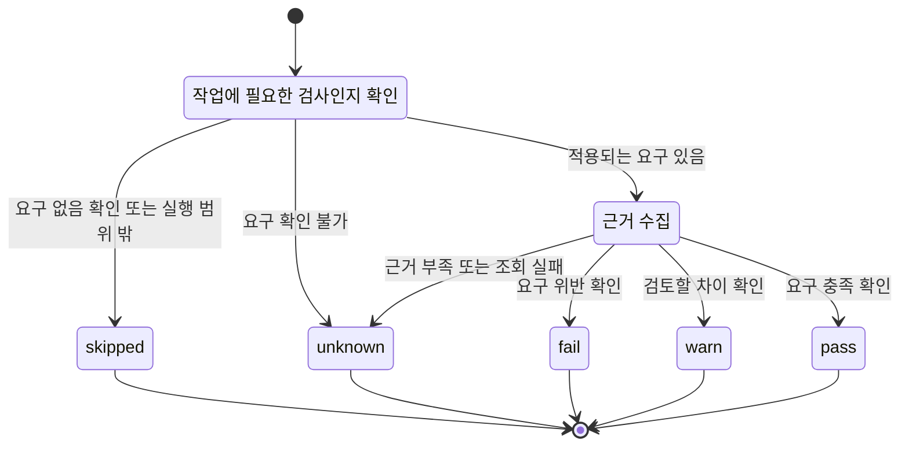

# 플러그인의 환경 점검 설계안

기준일은 2026-11-17입니다.
이 문서는 [권장 Windows 개발환경](windows-environment.md)을 재현 가능한 점검으로 연결합니다.
점검 ID와 결과 형식은 0.2.0 CLI의 점검 계약입니다.
실제 호스트의 검증 범위는 [검증 기록](verification.md)에서 별도로 확인합니다.
doctor는 30개 ID를 반환합니다.
기동과 프로젝트 코드 실행은 validate의 명시적인 실행 범위로 구분합니다.

## 점검의 입력과 실행 범위

입력은 대상 프로젝트의 절대 경로와 수행하려는 작업입니다.
언어별 작업의 범위는 Node.js·Python·Go·Rust·Zig·C#입니다.
문서 편집과 Linux·컨테이너 실행 문맥도 관련되는 경우 함께 점검합니다.
여섯 언어는 언어별 점검 범위입니다.
WSL 2와 Linux 컨테이너는 그 언어를 실행하는 공통 환경으로 취급합니다.
사용자가 작업을 지정하지 않으면 저장소의 선언 파일에서 요구를 찾습니다.
도구 요구가 없음을 확인하면 해당 검사를 생략합니다.
요구 파일을 읽지 못하면 요구 미확인으로 남깁니다.

기본 점검은 선언 파일 읽기와 명령 경로 탐색부터 수행합니다.
명령 실행은 출처를 확인한 로컬 도구의 조회 동작으로 제한합니다.
다운로드나 초기 설정을 유발할 수 있는 shim과 실행 별칭은 실제 대상을 먼저 확인합니다.
동작을 확인할 수 없는 래퍼는 실행을 보류하고 그 이유를 기록합니다.
기존 프로필의 효과는 현재 셸의 관찰값으로 기록합니다.
별도의 프로필을 실행하거나 셸 초기화 코드를 평가하지 않습니다.
새로 실행한 진단 프로세스의 셸은 사용자의 기존 대화형 세션과 구분합니다.
설정을 읽지 않은 Nushell 조회로 사용자 프로필의 alias·함수·mise 활성화를 확인했다고 표시하지 않습니다.

기본 점검에는 설치, 업데이트, 패키지 복원, 로그인, 프로필 수정, PATH 변경을 포함하지 않습니다.
WSL 배포판 기동과 Docker 엔진 기동은 기본 점검에 포함하지 않습니다.
연결 요청 자체로 엔진이 기동될 수 있는 대상은 기본 연결 조회를 보류합니다.
해당 조회는 이미 허용된 작업 범위에 기동 가능성이 포함될 때만 수행합니다.
프로젝트 빌드와 테스트는 환경 점검 이후의 개발 작업으로 구분합니다.
도구가 자체적으로 로그나 캐시를 만드는지 여부는 구현 시 실제 파일 변경으로 검증해야 합니다.

## 첫 구현의 점검 항목

P0는 첫 구현의 대상입니다.
프로젝트별 항목은 해당 요구가 확인된 경우에만 적용합니다.
표의 명령은 독립된 확인 절차의 예시입니다.
플러그인은 문자열을 셸 코드로 합성하지 않고 확인한 실행 경로와 인수 배열로 실행하도록 제안합니다.

| ID | 적용 조건 | 수집할 근거와 확인 방법 | 판정 기준 |
| --- | --- | --- | --- |
| ENV-01 | 모든 점검 | `Get-CimInstance Win32_OperatingSystem`의 제품명·버전·빌드·OS 아키텍처, .NET 런타임 정보의 프로세스 아키텍처 | 에디션·서비스 채널별 지원표 대조, 미검증 조합은 지원 미확인 |
| ENV-02 | 모든 점검 | `Get-Location`과 경로 해석, Windows 드라이브·UNC·WSL 내부·`/mnt/*` 구분 | 실행 문맥과 파일 위치의 조합으로 설명, `wsl.exe` 존재와 현재 WSL 실행 구분 |
| SH-01 | 모든 점검 | 점검 프로세스의 셸 경로·버전, 관찰 가능한 사용자 터미널·앱 통합 터미널·에이전트·보조 조회 셸, 해당 셸의 설정 메타데이터 | Nu·PowerShell·Bash 문맥 구분, 보조 `pwsh` 버전과 사용자 대화형 셸 구분 |
| PATH-01 | 필요한 각 명령 | PowerShell의 `Get-Command <이름> -All` 또는 Nushell의 `which --all`, 명령 종류·후보 경로·alias·함수·shim | 조회한 셸과 설정 적용 상태를 함께 기록, 복수 후보만으로 충돌 확정 금지 |
| REQ-01 | 모든 점검 | 개발 지침·런타임 선언·잠금 파일·CI의 관련 필드와 적용 범위 | 모순된 요구는 경고, 미지원 버전 표현은 미확인 |
| PKG-01 | 설치 경로 제안 | `winget --version`, 기존 Scoop·Chocolatey·기업 배포 경로 | 현재 설치·업데이트 책임 확인, 명령 해석 실패와 App Installer 부재 구분 |
| GIT-01 | Git 작업 | `git --version`, `git rev-parse --show-toplevel`, 인증 helper 이름 요약 | Git 실행·저장소 접근·원격 인증을 별도 기록, 로컬 성공과 push 가능 여부 구분 |
| GIT-02 | Git 작업 | `.gitattributes`·`.editorconfig`, `git ls-files --eol` | 저장소 정책 기준으로 판정, 전역 설정 변경과 자동 정규화 제외 |
| NODE-01 | Node.js 요구 | `engines.node`·`.nvmrc`·`.node-version`·`mise.toml`·`.tool-versions`, 확인한 Node의 `--version`·`process.execPath` | 프로젝트 버전 범위와 대조, 앱 번들 런타임과 프로젝트 런타임 구분 |
| NODE-02 | Node.js 패키지 작업 | `packageManager`·`devEngines`·지침·CI, `package-lock.json`·`npm-shrinkwrap.json`·`pnpm-lock.yaml`·`yarn.lock` | 동일 작업 범위의 선언 충돌 확인, 주요 버전별 의미 구분, 자동 설치 shim 기동 제외 |
| PY-01 | Python 요구 | `requires-python`·`.python-version`·기존 환경 설정, 확인한 인터프리터의 버전·`sys.executable`·`sys.prefix`·`sys.base_prefix` | 요구 버전과 대조, Store 별칭·설치 관리자와 실제 인터프리터 구분 |
| PY-02 | Python 의존성 작업 | 기존 환경의 `pyvenv.cfg`, `uv.lock`, requirements·Poetry·Conda 선언 | 환경과 잠금 방식의 일치 확인, 폴더 존재와 정상 실행 구분 |
| GO-01 | Go 요구 | `go.mod`·`go.work`·`go.sum`·`.go-version`·mise 선언, 확인한 Go의 버전·필요 환경 필드 | 최소 Go 요구·선호 도구 모음·무결성 해시 구분, 기본 조회 중 자동 다운로드 제외 |
| RUST-01 | Rust 요구 | `rust-toolchain.toml`·`rust-toolchain`·`Cargo.toml`·`Cargo.lock`, 설치 목록과 실제 rustc·Cargo 버전·host | 최소 Rust 버전과 정확한 도구 모음 구분, mise·rustup 선택의 일치와 자동 동기화 가능성 확인 |
| ZIG-01 | Zig 요구 | `.zig-version`·mise 선언·`build.zig.zon`·CI의 버전, 확인한 Zig의 `zig version` | 최소 선언과 고정 버전 구분, 정식·개발 빌드 구분, 기본 점검에서 `build.zig` 실행 제외 |
| DOTNET-01 | C# 요구 | `global.json`·대상 프레임워크, `dotnet --list-sdks`·`dotnet --list-runtimes`, 실제 SDK 선택 | SDK·런타임과 호스트 아키텍처 구분, `rollForward`·`paths`·상위 선언·`DOTNET_ROOT` 고려 |
| TOOLS-01 | 여섯 계열의 도구 관리 비교 | mise 선언·활성화·백엔드와 기존 관리자, 검증된 `mise ls --installed --json`·`mise which` | 설치 목록과 현재 선택 구분, 지원하지 않는 백엔드·설정 표현은 미확인, .NET 공식 설치 예외 반영 |
| WSL-01 | Linux 개발 또는 WSL 확인 요구 | 호스트의 `wsl --status`·`wsl --version`·`wsl --list --verbose` | WSL 기능·도구 버전·등록 배포판·세대·실행 상태 구분, 배포판 자동 기동 제외 |
| CTR-01 | 컨테이너 작업 또는 Docker 확인 요구 | 확인한 Docker CLI의 `docker --version`·`docker compose version`, context와 재지정된 대상의 메타데이터 | CLI·Compose·선택 대상 구분, 서버 응답·로컬 엔진 정상 여부는 별도 판정 |
| LD-01 | 컨테이너 개발과 관리 | Lazydocker 경로·릴리스 정보·OS·아키텍처, Compose 명령과 연결 대상 설정 | 미기동 상태에서 권장 차이 확인, 조회 부작용이 검증된 버전 조회만 사용, 엔진 연결은 CTR-02 |
| PC-01 | 여러 로컬 개발 프로세스 또는 기존 Process Compose 사용 | `process-compose` 경로·로컬 버전 메타데이터, 프로젝트 설정의 셸·작업 경로·의존 순서·헬스체크 | 버전 조회의 공통 초기화·로그·네트워크 확인, 기본 점검에서 TUI·서버·프로세스 기동 제외 |
| RCM-01 | 모든 환경 제안 | 적용되는 역할의 권장 도구·현재 도구·버전 정책, 프로젝트 제약·사용자 선택 | 실행 가능 여부와 별도 비교, 차이가 있으면 전환안 또는 유지 예외 제안, 근거 부족은 미확인 |

프로세스 아키텍처는 OS 아키텍처와 별도로 수집합니다.
PowerShell 조회의 `$PSVersionTable`과 실행 정책은 해당 PowerShell 프로세스의 관찰값으로 기록합니다.
Nushell의 Windows 관리 조회가 필요하면 검증된 `pwsh` 보조 프로세스와 명시적인 JSON 출력을 검토합니다.
보조 프로세스를 실행할 수 없으면 해당 조회를 미확인으로 남깁니다.
Nu와 PowerShell의 PATH 결과를 비교할 때는 작업 경로와 프로필 적용 상태도 함께 기록합니다.
mise 활성화와 디렉터리 이동 후 갱신 시점은 셸별로 확인합니다.
가상환경 인터프리터의 실행 가능 여부는 파일 존재와 별도로 확인합니다.
버전 범위는 Node.js, Python, .NET의 각 규칙에 맞게 비교해야 합니다.
모든 버전 표현을 하나의 숫자 비교나 문자열 비교로 처리하지 않습니다.
프로젝트 요구와 일치하는지와 공급자의 지원 기간 안에 있는지는 별도 판정합니다.
지원 상태에는 공식 자료의 확인일과 적용되는 OS·아키텍처를 기록합니다.
지원 자료가 없거나 오래돼 적용 여부를 확인하지 못하면 미확인으로 남깁니다.

REQ-01은 지침·CI와 함께 Dockerfile·Compose 파일·`.devcontainer` 설정의 관련 필드도 읽습니다.
Process Compose를 사용하는 프로젝트에서는 `process-compose.yaml`과 적용되는 override 설정도 확인합니다.
이 파일의 존재만으로 컨테이너 실행이 모든 작업의 필수 요구라고 판정하지 않습니다.
언어 도구가 필요한 실행 위치를 Windows 호스트·WSL 배포판·컨테이너로 구분합니다.
호스트에서 도구를 찾지 못했다는 사실을 WSL 내부나 컨테이너의 도구 부재로 바꾸지 않습니다.
컨테이너 안에서만 필요한 언어 도구를 호스트의 필수 설치로 제안하지 않습니다.

WSL-01과 CTR-01은 첫 단계의 호스트 조회입니다.
배포판 내부 실행과 엔진 연결 검증은 WSL-02와 CTR-02로 구분합니다.
Docker Desktop 사용에 사용자용 Ubuntu 등록을 일괄 필수 조건으로 삼지 않습니다.
Linux 개발이나 배포판과의 연계 요구가 확인되면 해당 배포판의 준비 상태를 따로 판정합니다.

Lazydocker는 Docker와 Compose의 실제 실행 경로 및 연결 대상과 함께 대조합니다.
출처와 해당 버전의 부작용을 확인한 경우에만 `lazydocker --version` 조회를 사용하도록 제안합니다.
인자 없는 Lazydocker 실행은 TUI 기동으로 취급합니다.
기본 점검은 컨테이너 재시작·삭제·볼륨 정리·로그 수집을 실행하지 않습니다.

Process Compose의 `process-compose version --short`는 관리 대상 프로세스 기동과 구분합니다.
현재 소스에서는 공통 초기화가 로그 기록이나 업데이트 확인을 수행할 수 있습니다.
해당 동작이 검증되기 전에는 기본 점검에서 이 명령을 순수 조회로 실행하지 않습니다.
대신 설치 메타데이터와 설정을 읽고 확인할 수 없는 버전은 미확인으로 남깁니다.
Windows에서 실행 중인 PowerShell과 Process Compose가 선택한 프로세스 실행 셸은 따로 기록합니다.
`is_tty` 같은 플랫폼 제약이 있는 기능은 대상 릴리스와 OS의 지원 조건을 별도로 확인합니다.
환경변수의 참조 이름은 확인할 수 있지만 실제 비밀 값은 결과에 복사하지 않습니다.

Go 조회에서는 원래의 `GOTOOLCHAIN` 선택 조건을 기록합니다.
Go 1.21 이상의 `go` 지시문은 최소 버전 요구로 해석합니다.
`toolchain`의 선호 버전을 정확한 버전 고정과 구분합니다.
로컬 도구 모음만 확인하는 자식 프로세스에는 `GOTOOLCHAIN=local`을 적용하도록 제안합니다.
이 임시 조건은 사용자 설정과 `go env -w`를 변경하지 않습니다.
로컬 조회 버전과 자동 선택 모드의 예상 버전을 같은 관찰값으로 취급하지 않습니다.
`go.sum`은 의존성의 무결성 해시로 해석합니다.
해당 파일의 부재만으로 잠금 파일 누락이나 환경 오류를 판정하지 않습니다.
`go mod tidy`·`go get`·`go mod download`·`go mod verify`는 기본 점검에서 실행하지 않습니다.

Rust 조회는 먼저 설치된 도구 모음과 실제 실행 대상을 확인합니다.
rustup proxy를 통한 호출에 자동 동기화 가능성이 있으면 기본 조회를 보류합니다.
`rustup show`와 `rustup toolchain list`도 설치된 rustup 버전의 부작용을 확인한 뒤 사용합니다.
자동 설치 차단을 지원하는 rustup 버전이면 자식 환경의 `RUSTUP_AUTO_INSTALL=0`을 검토합니다.
동기화 없는 조회가 확인되면 설치된 도구 모음의 실행 파일에 직접 버전 조회를 수행할 수 있습니다.
`RUSTUP_TOOLCHAIN`과 프로젝트의 선언 및 mise 설정을 함께 대조합니다.
`rust-version`의 최소 요구와 `rust-toolchain.toml`의 선택 버전은 구분합니다.
기본 점검은 `cargo build`·`cargo metadata`·`rustup update`를 실행하지 않습니다.

Zig의 `minimum_zig_version`은 정확한 컴파일러 고정과 구분합니다.
필드의 의미와 지원 여부는 대상 Zig 버전의 문서를 기준으로 해석합니다.
`zig build`는 프로젝트 코드를 실행할 수 있는 개발 작업으로 분리합니다.
편집기 지원을 검토할 때는 Zig와 ZLS의 호환 버전도 별도로 확인합니다.

C#의 공식 .NET SDK 설치는 mise 권장 구성의 기록된 예외로 처리합니다.
mise로 SDK를 공급하는 경우에는 SDK 목록과 실제 선택 결과를 따로 기록합니다.
공유 설치에서는 `mise.toml`의 선택만으로 .NET SDK를 고정했다고 판정하지 않습니다.

## 권장 구성과의 비교

RCM-01은 기존 도구가 정상 동작해도 수행합니다.
적용하는 권장 구성의 정책 버전과 대상 역할을 기록합니다.
현재 도구와 권장 도구의 차이를 실행 요구 충족 여부와 별도 필드로 기록합니다.
예를 들어 fnm 환경의 Node.js 실행은 통과하면서 권장 도구 mise와의 차이를 보고할 수 있습니다.
mise 전용 명령을 생략해도 이 차이의 비교를 생략하지 않습니다.

`recommendation.status`에는 다음 값을 사용하도록 제안합니다.

| 값 | 의미 | 제안 동작 |
| --- | --- | --- |
| `aligned` | 적용되는 권장 구성과 일치 | 현재 구성 활용 |
| `different` | 적용되는 권장 구성과 차이 확인 | 권장 전환안과 유지 예외 제시 |
| `not_applicable` | 해당 도구 역할이 필요 없음 | 도입 제안 생략 |
| `unknown` | 현재 도구나 적용 조건을 확인하지 못함 | 부족한 근거 표시 |

차이가 있다는 이유로 기능 점검의 `pass`를 `fail`로 바꾸지 않습니다.
RCM-01의 차이는 제안용 `warn`으로 표시할 수 있습니다.
역할별 전환 제안과 프로젝트 요구 위반을 보고서에서 구분합니다.
이미 선택한 유지 예외에는 이유와 적용 범위를 남깁니다.
유지 예외를 선택해도 권장 구성과의 차이는 계속 표현합니다.
후속 제안은 기록한 선택을 반영합니다.
Windows 네이티브의 대화형 셸과 관리 작업에는 PowerShell 7.6 LTS를 기본 권장합니다.
해당 역할의 PowerShell은 경로·버전·지원 상태와 함께 기본 권장 구성에 대조합니다.
Nu는 선택 도구이므로 설치 부재를 경고나 실패로 처리하지 않습니다.
Nu가 설치돼 있다는 사실만으로 권장 차이를 보고하지 않습니다.
사용자의 기본 대화형 셸이 Nu이면 PowerShell 전환안 또는 기록된 유지 예외를 제시합니다.
Windows 관리 작업의 PowerShell 요구는 해당 역할에서 별도로 판정합니다.
앱의 에이전트와 사용자 대화형 셸의 실제 실행 문맥은 별도로 수집합니다.

전환안에는 변경 대상, 보존할 프로젝트 요구, 검증 방법, 복구 방법을 포함합니다.
전환 가능성을 검증하지 못했으면 제안에 미확인 조건을 표시합니다.
조회 결과와 전환안 작성은 환경 변경을 수행하지 않습니다.
전환 요청이 있으면 그 요청이 포함한 범위에서 설정 기능을 실행합니다.

아래 JSON은 권장 차이와 전환안 필드를 설명하는 가상 예시입니다.
정책 버전의 명칭은 설계 예시입니다.
실제 점검 결과의 공통 실행 문맥은 생략했습니다.

```json
{
  "checkId": "RCM-01",
  "status": "warn",
  "reason": "recommendation_difference",
  "recommendation": {
    "policyVersion": "proposal-1",
    "role": "runtime-version-manager",
    "currentTool": "fnm",
    "expectedTool": "mise",
    "status": "different",
    "action": "propose_migration",
    "reason": "런타임 버전 관리의 공통 권장 구성으로 제안합니다.",
    "exception": null,
    "migration": {
      "preserve": ["프로젝트 지정 Node.js 버전", "기존 패키지 관리자", "잠금 파일", "기존 빌드 명령과 CI"],
      "changes": ["mise의 버전 선택 설정", "기존 관리자와 셸 초기화의 관계 조정"],
      "verify": ["실제 Node.js 실행 경로와 버전", "기존 프로젝트의 검증 명령"],
      "rollback": ["전환 전 셸 설정과 버전 선택 설정 복원"],
      "execution": "not_requested"
    }
  }
}
```

## 요구가 있을 때 확장할 점검

P1은 첫 구현 이후의 확장 대상입니다.
선택 도구가 없다는 이유만으로 전체 환경을 실패 처리하지 않습니다.

| ID | 적용 조건 | 확인 방법 | 판정의 한계 |
| --- | --- | --- | --- |
| RUST-02 | Rust의 Windows 네이티브 링크 요구 | 선택한 host·target, 설치된 대상·구성 요소와 요구되는 MSVC·Windows SDK 메타데이터 | 컴파일러 실행 성공과 링크 가능 여부 구분, MSVC와 GNU 대상의 요구 분리, 실제 빌드는 별도 작업 |
| WSL-02 | 지정 배포판의 개발 작업 | 배포판 이름·Linux 작업 경로·셸·Linux용 mise·해당 언어 도구, 요청된 Docker 연계 | 실제 내부 조회는 기동 가능성이 허용된 범위에서 수행, Windows 도구와 Linux 도구 구분 |
| CTR-02 | 지정 엔진의 연결·실행 검증 | 실제 endpoint의 `docker version` 서버 응답·엔진 OS·아키텍처, 요청된 범위의 이미지·컨테이너 동작 | 원격 대상과 로컬 Desktop 구분, 소켓 활성화 가능성 확인, 연결 실패와 설치 부재 구분 |
| PC-02 | 요청한 로컬 개발 서비스 실행 | 프로젝트의 Process Compose 설정과 기존 실행 명령, 프로세스 상태·준비 상태·종료 결과 | 시작·재시작·중지 대상의 범위 명시, 포트·의존 관계·정상 종료 확인, 정적 점검과 분리 |
| IDE-01 | 편집기 또는 네이티브 빌드 | 확인한 `code` 대상의 버전, C++ 설치 메타데이터·요구 workload | PATH 부재와 편집기 부재 구분, `cl`의 Developer Shell 초기화 필요성 구분 |
| CODEX-01 | Codex 플러그인 사용 | 실행 표면·사용 가능한 셸·파일 기능·권한 오류, 통합 터미널의 셸 선택과 에이전트 실행 환경, 구현 후 매니페스트와 발견·호출 확인 | CLI 부재와 앱 부재 구분, 외부 터미널·통합 터미널·에이전트 셸 구분, 요청한 셸의 기본값 지원은 실제 설정과 새 세션으로 검증 |
| AUX-01 | 검색 또는 GitHub 작업 | `rg --version`·`gh --version` | 로컬 실행·원격 인증·네트워크 구분, 토큰 조회 제외 |
| STORE-01 | Dev Drive 검토 | 대상 볼륨의 `Get-Volume`, 해당 볼륨을 지정한 `fsutil devdrv query` | ReFS와 Dev Drive 지정 여부 구분, 권한·지원 옵션 실패는 미확인, 생성·이동 제외 |

WSL과 Docker의 조회 명령도 해당 실행 버전에서 부작용을 확인해야 합니다.
지원하지 않는 조회 옵션의 실패는 기능 부재와 구분합니다.
Docker Desktop의 구독 적용 여부는 조직의 이용 조건을 확인해야 합니다.
플러그인은 CLI 출력으로 계약 상태를 확정하지 않습니다.
Docker context는 환경변수와 명령행 옵션으로 재지정될 수 있습니다. [Docker context 규칙](https://docs.docker.com/engine/manage-resources/contexts/)
Docker는 systemd 소켓 활성화를 지원합니다. [Docker daemon 소켓](https://docs.docker.com/reference/cli/dockerd/#daemon-socket-option)
이 문서에 근거하면 해당 구성의 연결 조회도 엔진을 기동할 가능성이 있습니다.
기동 가능성을 배제하지 못하면 연결 조회의 생략 이유를 남깁니다.
Windows 컨테이너 요구는 Linux 엔진의 응답으로 충족했다고 판정하지 않습니다.
Docker CLI·Compose 조회의 성공은 이미지 빌드나 컨테이너 실행 성공의 근거가 아닙니다.

## 판정과 근거의 분리

각 점검에는 적용 여부, 명령 발견, 실행 결과, 요구 충족 여부를 별도 필드로 남깁니다.
환경 보고서는 프로젝트 요구 충족·공식 지원 상태·권장 구성 일치를 각각 표현합니다.
개별 점검의 상태는 아래 의미로 사용하도록 제안합니다.

| 상태 | 의미 | 예 |
| --- | --- | --- |
| `pass` | 적용되는 요구의 충족 근거 확보 | Node.js 요구 범위를 만족하는 실제 실행 버전 |
| `fail` | 적용되는 요구의 위반 근거 확보 | 선언 범위 밖의 실제 Node.js 버전 |
| `warn` | 실행을 막는다고 확정하지 않은 검토 사항 | 동일 작업의 서로 다른 패키지 관리자 선언 |
| `unknown` | 근거 부족이나 조회 실패 | 접근 거부·시간 초과로 버전 확인 불가 |
| `skipped` | 요구 없음 확인 또는 실행 범위에서 제외 | Node.js 요구가 없음을 확인한 문서 저장소 |

`resolution`에는 `resolved`, `not_resolved`, `unknown`을 사용합니다.
`execution`에는 `not_run`, `succeeded`, `failed`, `timed_out`을 사용합니다.
`compatibility`에는 `satisfied`, `violated`, `unknown`, `not_applicable`을 사용합니다.
`not_resolved`는 현재 문맥에서 명령을 찾지 못했다는 의미입니다.
컴퓨터 어디에도 설치되지 않았다는 의미로 사용하지 않습니다.
필수 명령이 해석되지 않아 작업을 수행할 수 없으면 그 조건의 부족을 보고합니다.
그때도 설치 부재와 PATH 문제 중 원인은 확정하지 않습니다.

`support.status`에는 `in_support`, `end_of_support`, `unknown`을 사용합니다.
지원 상태가 미확인이면 요구 버전과의 일치만으로 종합 호환성 통과를 선언하지 않습니다.
지원 종료가 확인되면 해당 근거를 별도 경고로 표시합니다.
각 항목의 상태는 그 항목이 확인하는 요구에 한정합니다.



## 결과 형식의 예

다음 JSON은 버전 불일치 사례를 설명하기 위한 가상 데이터입니다.
현재 PC를 점검한 출력이 아닙니다.
실제 결과에는 점검 시작 시각과 플러그인 버전도 기록하도록 제안합니다.

```json
{
  "schemaVersion": 1,
  "checkId": "NODE-01",
  "status": "fail",
  "reason": "version_mismatch",
  "context": {
    "environment": "windows-native",
    "cwd": "C:\\example\\app",
    "shell": "pwsh",
    "processArchitecture": "x64"
  },
  "requirement": {
    "source": "package.json#engines.node",
    "value": ">=24 <25"
  },
  "resolution": "resolved",
  "resolvedPath": "C:\\example\\tools\\node.exe",
  "execution": "succeeded",
  "command": {
    "executable": "C:\\example\\tools\\node.exe",
    "arguments": ["--version"],
    "exitCode": 0
  },
  "observed": "v26.0.0",
  "compatibility": "violated",
  "support": {
    "status": "unknown",
    "source": null,
    "checkedOn": null
  },
  "nextAction": "기존 관리 방식으로 프로젝트 지정 버전을 선택합니다."
}
```

표시 문구와 `nextAction`은 한국어로 제공합니다.
원시 stdout과 stderr는 크기를 제한합니다.
인증정보가 섞일 수 있는 출력은 저장 전에 필드 단위로 제한합니다.
환경변수 전체, Git 설정 전체, 인증 helper의 임의 스크립트, 원격 URL의 사용자정보를 보고서에 복사하지 않습니다.
보고서 파일은 사용자가 요청한 위치에 저장합니다.
개인 PC의 설치 경로를 저장소의 기본 설정으로 복사하지 않습니다.

## 수용 사례

아래 사례는 점검 기능의 수용 기준입니다.
자동 테스트와 실제 호스트에서 확인한 범위는 [검증 기록](verification.md)에서 구분합니다.

| 사례 | 기대 결과 | 잘못된 구현으로 판단할 조건 |
| --- | --- | --- |
| 알려진 절대 경로만 실행 가능 | 현재 문맥의 해석 실패와 설치 존재를 함께 기록 | 미설치 확정 |
| 같은 이름의 도구가 서로 다른 버전 반환 | 선택된 경로와 다른 후보 기록 | 후보 수만으로 실패 확정 |
| 접근 거부·비정상 종료·시간 초과 | 실행 상태와 원인 미확인 구분 | 도구 부재나 버전 불일치로 변환 |
| 호스트 버전과 프로젝트 요구가 다름 | 프로젝트 요구 기준으로 차이 보고 | 최신 버전이라는 이유로 통과 |
| 런타임 요구가 없는 문서 저장소 | 해당 런타임 검사 생략 | 선택 도구 부재로 전체 실패 |
| 요구 선언 파일의 접근 실패 | 요구 미확인과 조회 실패 기록 | 요구가 없다고 간주해 생략 |
| fnm으로 프로젝트 지정 Node.js가 정상 실행 | 실행 요구 통과와 mise 전환 제안을 함께 표시 | mise 전환 제안 누락 또는 실행 환경 실패 처리 |
| 사용자가 기존 관리자 유지를 선택 | 이유·적용 범위와 권장 구성 차이를 기록 | 정상 실행 상태를 실패로 변경 |
| 해당 런타임 작업이 없는 프로젝트 | 런타임 관리자 도입 제안 생략 | 통일성을 이유로 불필요한 설치 제안 |
| 전환안만 작성한 점검 | 현재 런타임·프로필·PATH·잠금 파일 유지 | 제안 중 설치나 설정 변경 실행 |
| 프로젝트가 더 새 Go 도구 모음을 요구 | 로컬 버전과 선언을 다운로드 없이 기록 | 조회 중 자동 다운로드 또는 낮은 로컬 버전을 자동 선택 결과로 오인 |
| `go.sum`이 필요 없는 Go 프로젝트 | 선언과 의존성 조건을 기록 | 파일 부재만으로 환경 실패 |
| mise의 Rust 선택과 프로젝트 선언이 다름 | 실제 도구 모음과 선언 차이 표시 | `rustc` 실행 성공만으로 프로젝트 요구 통과 |
| Rust proxy 대상이 미설치 | 기본 조회 보류와 이유 표시 | 버전 조회를 위해 도구 모음 동기화 |
| Zig 프로젝트가 컴파일러 버전을 고정 | 고정 버전과 최소 요구를 구분해 대조 | 최신 Zig라는 이유로 통과 |
| .NET 공유 경로에 SDK 여러 개 설치 | `global.json`과 실제 선택 결과 대조 | mise 선언만으로 SDK 선택 확정 |
| Corepack·mise 대상 도구 미설치 | 다운로드 없이 상태 보고 | 버전 확인 중 자동 설치 |
| WSL 배포판·Docker 엔진 중지 | 기본 단계의 자동 기동 없음 | 조회를 위한 자동 기동 |
| Docker Desktop만 사용하고 사용자용 Ubuntu가 없음 | Docker 요구와 배포판 개발 요구를 구분 | Ubuntu 부재만으로 컨테이너 환경 실패 |
| Docker CLI·Compose는 실행되지만 엔진 연결은 미수행 | 클라이언트 확인과 서버 미확인을 각각 기록 | 엔진 정상이나 컨테이너 실행 가능으로 확정 |
| WSL이나 컨테이너에만 언어 도구가 필요 | 해당 실행 위치의 점검으로 연결 | 호스트 도구 부재를 오류로 판정 |
| context가 원격 엔진을 가리킴 | 실제 대상과 로컬 Desktop 상태 구분 | 원격 응답을 로컬 엔진 정상으로 판정 |
| Lazydocker의 조회 버전이 확인됨 | 해당 버전과 Docker·Compose의 요구만 대조 | 기본 점검 중 TUI 기동이나 컨테이너 변경 |
| Process Compose 설정만 있는 프로젝트 | 셸·작업 경로·의존 관계를 정적으로 확인 | 기본 점검 중 개발 서비스 기동 |
| 버전 조회가 로그나 업데이트 확인을 수행 | 부작용과 조회 보류 이유 기록 | 변경 없는 조회로 분류 |
| Windows의 Process Compose 설정이 Bash 명령 사용 | 실제 프로세스 셸과 명령 호환성 검토 | 현재 PowerShell 버전만으로 실행 가능 판정 |
| Nushell 사용 중 보조 PowerShell 조회 수행 | 대화형 셸과 보조 조회 셸을 각각 기록 | 보조 PowerShell을 사용자 셸로 표시 |
| 프로필을 읽지 않은 Nu에서 경로 조회 | 해당 조회 프로세스의 PATH 결과로 한정 | 사용자 세션의 alias·mise 활성화 상태로 일반화 |
| 대화형 셸로 Nushell 선택 | 실행 요구 충족과 PowerShell 권장안 또는 유지 예외를 구분 | Nu 선택만으로 실행 환경 실패 확정 |
| 지원 중인 권장 PowerShell 사용, Nu 없음 | 해당 역할의 권장 일치 확인 | Nu 설치나 전환 요구 |
| Nu가 설치됐지만 기본 셸은 권장 PowerShell | 실제 기본 셸을 기준으로 비교 | Nu 존재만으로 권장 차이 보고 |
| Windows Terminal은 Nu이고 앱 에이전트는 PowerShell | 사용자 셸의 권장 차이와 앱의 실행 문맥을 각각 기록 | 에이전트도 Nu로 변경됐다고 표시 |
| 통합 터미널에서 Nu를 자식 프로세스로 실행 | 실제 Nu 실행과 기본 셸 설정을 구분 | 앱 기본 셸이나 에이전트 셸 변경으로 확정 |
| 기본 대화형 셸 설정을 완료했다고 보고 | 새 터미널을 열면 수동 입력 없이 선택한 셸이 시작되는지 확인 | 매번 자식 셸 명령을 입력해야 하는 구성을 설정 완료로 처리 |
| 공식 터미널 선택 예시에 Nu가 없음 | 현재 앱의 선택 항목 확인 전까지 기본값 지원 미확인 | 문서 예시의 누락만으로 지원 불가 확정 |
| 현재 앱의 Windows 셸 선택 구현이 네 가지로 고정됨 | 확인한 앱 버전과 설정 항목에 Nu 직접 선택 기능이 없음을 기록 | 모든 앱 버전이나 자동 시작 우회 방법까지 지원 불가로 일반화 |
| 동일한 기본 점검을 두 번 실행 | 설치·프로필·PATH·잠금 파일 변경 없음 | 도구나 프로젝트 설정 변경 |

PATH가 원인이라는 가설은 같은 도구의 절대 경로 실행과 이름 실행을 같은 작업 경로에서 비교해 확인합니다.
두 실행이 같은 대상을 선택하는데도 동일하게 실패하면 PATH 가설을 기각합니다.
Docker 조회의 기동 가능성은 소켓 활성화가 설정된 별도 검증 환경에서 확인하도록 제안합니다.
daemon이 정지된 상태에서 조회 전후의 서비스 상태를 비교합니다.
같은 조건에서 기동이 재현되지 않으면 해당 대상의 조회 기동 가설을 기각합니다.
성능이나 호환성의 추가 주장은 해당 주장을 검증하는 별도의 조건을 갖춰야 합니다.

## 근거의 위치

도구의 역할과 선택 이유에 대한 공식 출처는 [환경 제안 문서](windows-environment.md)에 연결합니다.
mise의 대상 경로 조회는 [mise which](https://mise.jdx.dev/cli/which.html)를 기준으로 검토합니다.
mise의 설치 목록 조회는 [mise ls](https://mise.jdx.dev/cli/ls.html)를 기준으로 검토합니다.
위 공식 명령 문서의 확인일은 2026-11-17입니다.
Dev Drive 조회는 [fsutil devdrv](https://learn.microsoft.com/en-us/windows-server/administration/windows-commands/fsutil-devdrv)의 조회 동작을 기준으로 검토합니다.
문서상의 조회 성격과 이 플러그인에서 검증한 부작용 여부는 별개입니다.
Go 도구 모음 선택은 [Go toolchains](https://go.dev/doc/toolchain)를 기준으로 검토합니다.
Go 무결성 파일은 [Go modules](https://go.dev/ref/mod#go-sum-files)를 기준으로 검토합니다.
Rust 선택과 Windows 요구는 [rustup](https://rust-lang.github.io/rustup/)을 기준으로 검토합니다.
자동 설치 차단은 [rustup 1.29.0 변경 기록](https://github.com/rust-lang/rustup/blob/1.29.0/CHANGELOG.md)을 대상 버전과 대조합니다.
mise 연계는 [Rust 백엔드](https://mise.jdx.dev/lang/rust.html)와 [.NET 백엔드](https://mise.jdx.dev/lang/dotnet.html)를 기준으로 검토합니다.
Zig 선언은 [공식 매니페스트 문서](https://github.com/ziglang/zig/blob/master/doc/build.zig.zon.md)를 대상 버전과 대조합니다.
편집기 호환성은 [ZLS 설치 안내](https://zigtools.org/zls/install/)를 기준으로 검토합니다.
추가 공식 자료의 확인일은 2026-11-17입니다.
WSL 호스트 조회는 [WSL 기본 명령](https://learn.microsoft.com/en-us/windows/wsl/basic-commands)을 기준으로 검토합니다.
배포판 조건과 Compose 구성은 [Docker WSL 연계](https://docs.docker.com/desktop/features/wsl/)와 [Compose 설치](https://docs.docker.com/compose/install/)를 기준으로 검토합니다.
Lazydocker의 선택 조건은 [공식 저장소](https://github.com/jesseduffield/lazydocker)와 [설정 문서](https://github.com/jesseduffield/lazydocker/blob/master/docs/Config.md)를 대상 릴리스와 대조합니다.
Process Compose의 버전 조회는 [공식 버전 명령](https://github.com/F1bonacc1/process-compose/blob/main/src/cmd/version.go)과 [초기화 코드](https://github.com/F1bonacc1/process-compose/blob/main/src/cmd/root.go)를 대상 릴리스와 대조합니다.
