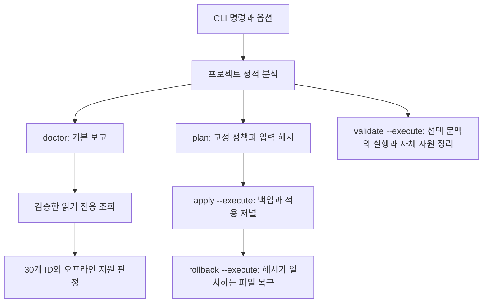

# 0.2.1 구현 구조와 검증 경계

이 문서는 0.2.1의 구현 구조와 검증 경계를 설명합니다.
기준일은 2026-11-17입니다.
명령 사용법은 [진단 CLI 사용법](diagnostic-cli.md)에 기록합니다.
모듈 사이의 반환 계약은 [모듈 계약](completion-contract.md)에 기록합니다.

## 실행 기준과 의존성

진단 CLI의 최소 런타임은 Node.js 24입니다.
Windows 호스트 조회는 PowerShell 7을 프로필 없이 실행합니다.
대상 프로젝트의 런타임·패키지 관리자·빌드 명령·배포 경로는 그대로 유지합니다.
진단기의 실행 조건을 맞추기 위해 대상 프로젝트를 재설정하지 않습니다.

| 구분 | 고정 의존성 | 역할 |
| --- | --- | --- |
| 실행 | `smol-toml@1.9.1` | 표준 TOML 파싱과 직렬화입니다. |
| 실행 | `yaml@2.9.1` | 표준 YAML 문서 파싱입니다. |
| 실행 | `semver@7.8.6` | Node.js 버전과 범위 비교입니다. |
| 실행 | `@renovatebot/pep440@6.0.0` | Python 버전과 범위 비교입니다. |
| 빌드 | `esbuild@0.28.2` | Node.js 24 대상의 설치용 CLI 번들 생성입니다. |

실행 의존성은 네 개이며 빌드 의존성은 별도로 고정합니다.
소스 개발과 검사는 저장소의 npm 잠금 파일을 기준으로 수행합니다.
설치용 번들은 실행 의존성을 포함하므로 대상 프로젝트에 진단기용 npm 의존성을 추가하지 않습니다.

## 모듈별 책임

| 모듈 | 현재 책임 |
| --- | --- |
| `src/project.mjs` | 선언·상위 적용 경계·작업 공간·CI·가상환경·컨테이너·서비스의 정적 분석입니다. |
| `src/windows.mjs` | Windows 문맥·명령 후보 수집과 PE 실행 파일 검증입니다. |
| `src/query.mjs` | 허용한 읽기 전용 조회와 명시적인 실행 작업의 전달입니다. |
| `src/versions.mjs` | 언어별 버전 요구와 관찰 버전의 비교입니다. |
| `src/runtime.mjs` | 실제 런타임 조회와 실행 파일 메타데이터의 선택 근거 보완입니다. |
| `src/advanced.mjs` | mise·.NET·Git·IDE·보조 도구·저장소 볼륨의 추가 조회입니다. |
| `src/infrastructure.mjs` | 패키지 관리자·Python 환경·WSL·Docker·Process Compose의 진단입니다. |
| `src/support.mjs` | 유효기간이 있는 오프라인 공식 지원 정책 판정입니다. |
| `src/app-check.mjs` | 선택한 Codex 실행 파일을 통한 앱 공유 설치 목록 조회입니다. |
| `src/configure.mjs` | 계획·적용·저널·백업·복구·유지 예외입니다. |
| `src/configuration-policy.mjs` | 설치 역할·패키지 ID·정확한 버전·명령 인수의 고정 정책입니다. |
| `src/validation.mjs` | 선택한 Rust·WSL·Docker·Process Compose 실행 검증입니다. |
| `src/service-session.mjs` | 검증에서 생성한 자식 서비스 세션의 시작과 정리입니다. |
| `src/task.mjs` | 명시적으로 신뢰한 호스트 개발 작업과 별도 `task` 결과입니다. |
| `src/doctor.mjs` | 30개 점검 ID의 통합 보고입니다. |
| `src/cli.mjs` | 명령·옵션·출력·명시적인 실행 요청의 처리입니다. |

독립적인 읽기 전용 조회와 문맥별 검증은 모듈 안에서 병렬로 수행할 수 있습니다.
파일 적용과 복구는 상태 잠금과 해시 비교를 거쳐 순서대로 진행합니다.
모듈이 연결되었다는 사실과 실제 호스트에서 성공했다는 사실은 구분합니다.



## 프로젝트 분석의 경계

분석 결과는 여섯 언어의 요구와 환경 적용 상태를 보존합니다.
TOML은 위험한 키를 거부하고 파싱 깊이를 제한합니다.
YAML은 중복 키·지원하지 않는 태그·재귀 별칭·확장 한도를 검사합니다.
기본 파일 읽기는 256 KiB, 선언 수는 128개, 탐색 깊이는 32단계로 제한합니다.
링크와 허용한 경계 밖의 파일은 따라가지 않습니다.

상위 선언은 저장소·적용되는 작업 공간·사용자 홈·파일 시스템 등의 경계 안에서 탐색합니다.
`global.json`과 언어 버전 파일은 가장 가까운 적용 선언을 선택합니다.
mise와 `.tool-versions`는 언어별로 가까운 선언을 우선합니다.
명시적인 패키지 작업 공간의 구성원만 추가 분석합니다.
CI의 버전 행렬은 로컬 버전 선택과 구분합니다.
가상환경의 관찰 버전을 프로젝트의 요구 버전으로 바꾸지 않습니다.

Process Compose와 Compose는 명령과 환경 값을 평가하지 않고 필요한 설정만 추출합니다.
devcontainer는 컨테이너 작업 문맥의 근거로 기록합니다.
보조 DB 서비스의 존재만으로 앱 전체의 컨테이너 실행을 추론하지 않습니다.
지원하지 않는 외부 포함과 동적 필드는 해당 필드의 구체적인 미확인 사유를 남깁니다.

## 기본 조회와 공식 지원 판정

기본 `doctor`는 설치·사용자 프로필 변경·서비스 기동을 수행하지 않습니다.
실행 경로와 PE 형식을 확인한 도구에 고정된 조회 인수 배열을 전달합니다.
미검증 wrapper·proxy·shim과 자동 설치를 유발할 수 있는 선택은 보류합니다.
프로필·시작 후크·프로젝트 명령을 기본 조회의 일부로 실행하지 않습니다.
내부 조회의 원시 출력은 필요한 관찰로 정리한 뒤 보고합니다.

공식 지원 판정은 2026-11-17 기준의 오프라인 정책 스냅샷을 사용합니다.
30일 유효기간을 지난 스냅샷은 최신 정책의 근거로 사용하지 않습니다.
현재 스냅샷의 만료일은 2026-12-17입니다.
지원 릴리스 계열의 판정은 최신 패치나 보안 취약점 확인과 구분합니다.

## 계획·적용·복구

계획은 선택한 역할과 정확한 버전에서 고정된 작업을 생성합니다.
기존 런타임 선언과 충돌하는 변경은 보류합니다.
계획에는 입력 해시와 보존할 프로젝트 선택을 포함합니다.
계획과 백업·저널·예외는 저장소 밖의 상태 디렉터리에 보관합니다.

적용은 명시적인 실행 요청과 검토한 계획을 요구합니다.
계획의 해시와 현재 입력을 다시 대조해 오래된 계획을 거부합니다.
같은 계획의 재실행과 변경 없는 결과는 정상 상태로 처리합니다.
복구는 도구가 기록한 변경과 현재 파일이 일치할 때 수행합니다.
동시 사용자 편집은 보존합니다.
공유 설치의 자동 제거는 수행하지 않으며 수동 복구 범위를 저널에 남깁니다.

## 선택 실행 검증

실행 검증은 `validate --execute`에서 선택합니다.
Rust 링크 검증은 임시 소스와 실제 산출물로 확인합니다.
WSL은 선택 배포판의 Linux 작업 경로와 실행 파일을 사용합니다.
선택적인 `--linux-tools`는 배포판 내부 도구의 조회 범위를 제한합니다.
Docker는 선택 context의 엔진 조회와 선택 이미지·Compose 서비스 검증을 구분합니다.
Process Compose는 설정한 서비스의 시작·준비 상태·종료를 구분합니다.
검증에서 만든 테스트 자원과 자식 세션만 정리합니다.
대상 프로젝트의 임의 빌드·스크립트는 별도로 선택한 작업일 때만 실행합니다.
작업 파일의 `context: "native"`는 허용한 호스트 도구와 문자열 인수 배열을 사용합니다.
`context: "rust"`와 `context: "wsl"`은 해당 실행 검증에서 처리합니다.
호스트 작업은 `trusted: true`와 `--execute`를 모두 요구합니다.
호스트 작업의 상태와 종료 코드는 별도 `task` 필드에 기록합니다.
원시 표준 출력과 표준 오류는 작업 결과에 포함하지 않습니다.

## 빌드와 패키지

```powershell
node --test
node scripts/check-package.mjs
npm run build
npm run package
```

번들 출력은 `dist/cli.mjs`입니다.
로컬 패키지는 `.local/plugin-marketplace` 아래에 생성합니다.
패키지에는 번들·PowerShell 지원 파일·문서·정책 자료·서드파티 고지를 포함합니다.
로컬 패키지 생성은 계정 등록이나 공개 게시를 의미하지 않습니다.

테스트와 형식·링크 검사는 구현 계약의 근거입니다.
실제 Windows에서 30개 ID의 doctor 보고서 생성을 확인했습니다.
Node.js·Python의 실제 실행과 Go PE 내장 버전 확인에 성공했습니다.
통제된 임시 프로젝트에서 계획 미리보기·적용·재적용·복구·예외 저장과 npm 작업의 실제 실행이 통과했습니다.
로컬 플러그인 0.2.0의 설치·활성과 앱 화면의 Skill 세 개 발견을 확인했습니다.
앱 스크린샷은 `.local/`에 보관합니다.

앱의 최초 0.2.0 실제 호출에서 30개 ID 보고서와 `CODEX-01: pass`를 확인했습니다.
Windows Job helper로 Process Compose 실서비스의 start·readiness·stop이 모두 통과했습니다.
정리 근거는 `forced: false`와 `proof: windows_job_empty`입니다.
현재 패키지와 소스 버전은 0.2.1입니다.
로컬 CIM 접근 실패 시 프로세스·레지스트리 메타데이터를 읽는 대체 경로를 반영했습니다.
최신 0.2.1의 실제 앱 재호출을 일반 샌드박스의 `use_default`로 완료했습니다.
첫 실행에서 권한 상승 없이 종료 코드 0을 확인했습니다.
메타데이터 출처는 `context.metadataSource: local-process-and-registry`입니다.
보고서의 checkId 30개는 모두 고유합니다.
결과는 통과 11개·실패 0개·검토 0개·미확인 4개·생략 15개입니다.
`CODEX-01: pass`에서 설치·활성과 버전 0.2.1을 확인했습니다.
전달된 소스 테스트는 총 264개 중 261개 통과·0개 실패·3개 생략입니다.
새 터미널의 수동 설정 선택과 셸·프로필 적용은 별도 검증으로 남깁니다.
기존 Ubuntu-24.04의 `/mnt/f/workspace/project/tttaliesin/windows-agent-devkit`에서 `--linux-tools bash`로 `WSL-02: pass`를 확인했습니다.
고정 조회로 Linux·x86_64, `/usr/bin/sh`, `/usr/bin/bash` 5.2.21을 확인했습니다.
전체 언어 도구의 WSL 설치와 프로젝트 개발 명령 실행을 확인한 결과는 아닙니다.
Docker 엔진은 검증할 호스트가 없어 CI·모의 조회의 확인 범위에 머뭅니다.
실제 사용자 프로필과 프로젝트 전체 개발 흐름의 검증도 별도로 남아 있습니다.
현재 확인 결과는 [검증 기록](verification.md)에서 관리합니다.

## 0.1 구현 이력

0.1.0은 외부 실행 의존성이 없는 첫 읽기 전용 CLI를 대상으로 했습니다.
P0 22개 ID의 제한된 분석을 제공했고 P1 8개와 설정 적용은 후속 작업이었습니다.
이전의 무의존성·루트 전용 분석 설명은 당시 범위에만 적용합니다.
현재 실행·빌드 의존성과 명령 계약은 이 문서의 0.2.1 기준을 따릅니다.
