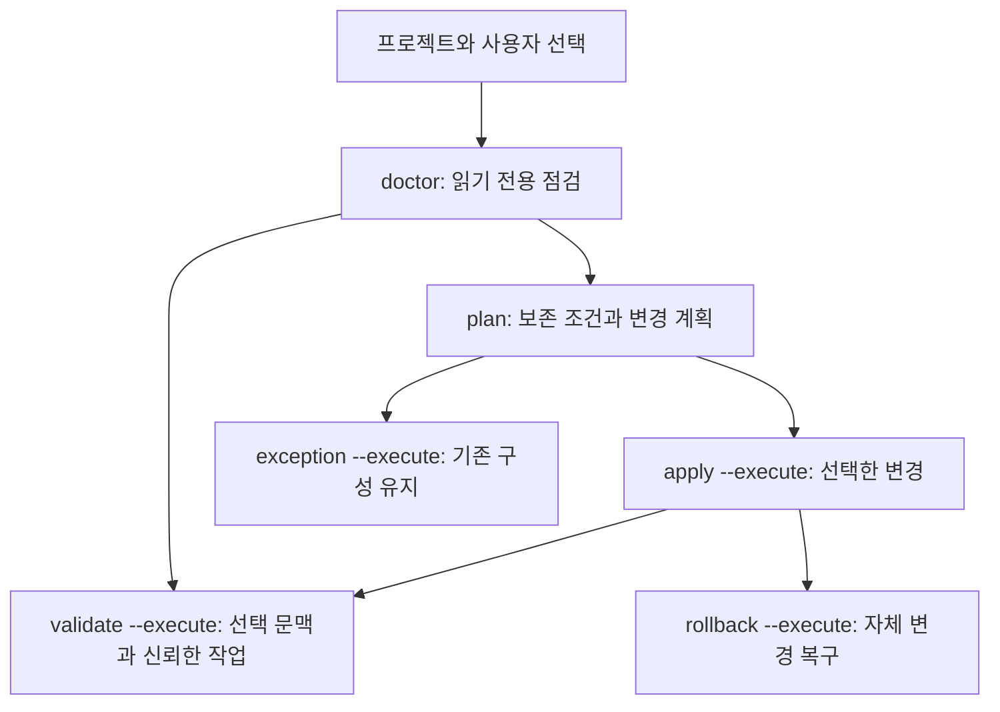

# Codex 플러그인의 기능 범위

이 문서는 로컬 플러그인이 다루는 점검·변경·실행 검증의 범위를 설명합니다.
배포 버전과 실제 Codex 앱 검증 결과는 [검증 기록](verification.md)에서 확인합니다.
명령 사용법은 [진단 CLI 사용법](diagnostic-cli.md)에 기록합니다.
전체 제품의 목적은 [프로젝트 범위](project-scope.md)에 기록합니다.

## 대상 환경

지원 대상 계열은 Node.js·Python·Go·Rust·Zig·C#입니다.
Node.js 계열에는 JavaScript와 TypeScript 프로젝트를 포함합니다.
C#은 .NET SDK를 기준으로 다룹니다.
필요한 계열은 프로젝트 선언과 사용자가 선택한 실행 문맥에서 결정합니다.

CLI의 실행 기준은 Windows 11 x64, Node.js 24 이상과 PowerShell 7입니다.
Windows 네이티브·WSL 2·Docker 기반 Linux 컨테이너를 서로 다른 실행 문맥으로 다룹니다.
이 범위는 모든 아키텍처와 도구 조합의 실호스트 검증 완료 목록이 아닙니다.
ARM64와 앱별 셸 동작은 별도 검증이 필요합니다.

## 기본 점검

기본 명령은 `doctor`입니다.
정적 분석과 허용한 읽기 전용 조회를 30개 점검 ID에 연결합니다.
프로젝트 요구·명령 후보·확인한 실행 버전·공식 지원 계열·권장 구성의 차이를 구분합니다.
조회 실패와 실제 요구 위반을 다른 결과로 보고합니다.
미검증 wrapper·proxy·shim은 실행을 보류합니다.
조회할 실행 파일은 경로와 PE 형식 등을 확인합니다.

상위 버전 선언, 명시적인 패키지 작업 공간과 GitHub Actions의 정적 요구를 분석합니다.
Python 가상환경은 선언된 요구와 실제 선택된 인터프리터의 관찰을 구분합니다.
Process Compose의 셸·작업 경로·의존·건강 확인·포트는 정적으로 확인합니다.
Compose 서비스와 devcontainer 문맥은 별도 근거로 기록합니다.
DB 서비스가 있다는 이유로 앱의 호스트 언어 요구를 제외하지 않습니다.
mise tasks·Taskfile·Justfile·Makefile·npm scripts는 선언을 정적으로 확인합니다.

기본 점검은 설치·사용자 프로필 변경·프로젝트 명령 실행·서비스 기동을 수행하지 않습니다.
WSL 호스트 조회는 배포판 내부 실행과 구분합니다.
Docker 클라이언트·context·Compose 조회는 엔진과 서비스의 실제 실행 검증과 구분합니다.
Lazydocker는 TUI 기동 없이 명령과 관련 메타데이터를 확인합니다.

## 환경 제안과 설정

`plan`은 선택한 역할과 정확한 버전을 기준으로 변경 계획을 생성합니다.
전환 계획은 기존 런타임 선언·패키지 관리자·잠금 파일·빌드 명령·CI 선택을 보존합니다.
기존 구성과 충돌하거나 선언을 확인하지 못한 작업은 보류합니다.
권장 구성과 다른 상태를 곧바로 기능 실패로 판정하지 않습니다.

`apply --execute --plan <파일>`은 검토한 계획을 적용합니다.
계획과 입력 해시가 달라지면 오래된 계획으로 적용하지 않습니다.
계획·백업·저널·유지 예외는 저장소 밖의 상태 디렉터리에 보관합니다.
같은 계획의 재적용과 변경 없는 결과는 중복 작업 없이 처리합니다.
프로필 변경은 `powershell-profile` 역할과 명시한 `--profile` 경로에 한정합니다.
앱의 기본 셸 설정과 새 터미널의 실제 셸 선택은 별도 검증입니다.

`rollback --execute --journal <ID>`는 기록된 자체 파일 변경을 복구합니다.
적용 이후 사용자 편집과 공유 설치는 보존합니다.
공유 설치의 제거 등 자동 복구할 수 없는 범위는 수동 작업으로 보고합니다.
`exception --execute --role <역할> --reason <이유>`는 해당 프로젝트의 유지 이유와 범위를 저장합니다.

## 개발 작업의 실행

`validate --execute`는 선택한 실행 문맥을 검증합니다.
Rust 링크, WSL 배포판 내부, Docker context·로컬 이미지·Compose, Process Compose 서비스를 대상으로 합니다.
Rust 링크 검증은 `--rust-targets` 또는 작업 JSON의 `context: "rust"`로 명시합니다.
WSL 검증은 기존 배포판과 배포판 내부의 Linux 절대 작업 경로를 사용합니다.
실행 대상 없이 메타데이터만 확인할 때는 `doctor`를 사용합니다.
서비스의 시작·준비 상태·종료를 별도 근거로 남깁니다.
준비 검사 없이 실행 중인 서비스를 준비 완료로 판정하지 않습니다.
자체 생성 자원과 자식 세션만 정리합니다.

`--task-file`은 선택한 개발 명령을 별도로 전달합니다.
`context: "native"`는 허용한 도구와 인수 배열을 프로젝트의 호스트 작업 경로에서 실행합니다.
`native`로 선택할 수 있는 도구에는 `mise`·`task`·`just`·`make`가 포함됩니다.
이 작업에는 `trusted: true`와 `--execute`가 필요합니다.
`native` 작업의 상태와 종료 코드는 `report.task`에 기록합니다.
`rust`와 `wsl` 작업의 근거는 `report.validation`에서 해당 ID의 `steps` 아래 `task` 단계에 기록합니다.
실행하지 못한 선택 작업 등 명시적으로 선택한 검증 항목이 `unknown` 또는 `skipped`이면 `validate --execute`는 종료 코드 1을 반환합니다.
원시 표준 출력·표준 오류·환경 값은 작업 보고서에 포함하지 않습니다.
실제 프로젝트의 전체 개발 흐름 성공은 해당 명령을 실행한 결과로 확인해야 합니다.

## 공식 지원의 해석

공식 지원은 2026-11-17 기준의 오프라인 정책 스냅샷으로 판정합니다.
스냅샷은 30일간 유효하며 만료일은 2026-12-17입니다.
기간 밖의 정책과 수록하지 않은 도구는 미확인으로 남깁니다.
릴리스 계열 지원은 최신 패치·취약점·모든 플랫폼 조합의 확인과 구분합니다.

## 패키지와 앱 검증

플러그인은 로컬 파일·프로세스 접근을 위한 로컬 패키지로 구성합니다.
기존 Codex 셸과 파일 기능으로 충족하는 작업에 별도 MCP 서버를 추가하지 않습니다.
클라우드 서버와 사이트 호스팅을 기본 의존성으로 두지 않습니다.
번들에는 실행 의존성 네 개를 포함합니다.
esbuild는 빌드할 때만 사용합니다.
배포 패키지는 설치 루트의 `dist/cli.mjs`를 진입점으로 사용합니다.
설치와 대상 프로젝트의 경로 지정 방법은 [CLI 사용법](diagnostic-cli.md#실행-전제조건)에 기록합니다.

`--app`은 앱과 공유하는 플러그인 설치 목록을 조회합니다.
`--ide`는 VS Code와 네이티브 빌드 도구의 선택적 점검을 요청합니다.
실제 Skill 호출의 근거는 Codex 앱에서 설치본의 CLI를 실행한 기록입니다.

## 이전 구현 이력

0.1.0은 제한된 정적 분석과 로컬 조회를 제공하는 첫 플러그인 소스였습니다.
설정 적용과 P1 실행 검증을 후속 범위로 남겼습니다.
0.2에는 계획·적용·복구·예외·선택 실행 검증을 구현했습니다.
0.2.1 및 이전 버전의 실제 호출은 과거 검증 이력입니다. [검증 기록](verification.md)
