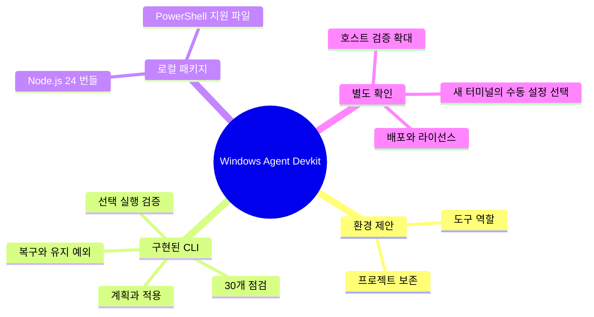

# 프로젝트의 목적과 범위

이 문서는 Windows Agent Devkit의 목적과 산출물 범위를 정의합니다.
기준 버전은 0.2.1입니다.
기준일은 2026-11-17입니다.

## 목적

사용자가 개발 작업에 필요한 Windows 환경을 선택하고 활용하도록 돕습니다.
권장 구성은 도구의 역할과 선택 이유를 설명합니다.
로컬 Codex 플러그인은 같은 기준으로 현재 환경을 점검하고 선택한 변경과 실행 검증을 지원합니다.
구현 결과와 실제 호스트·앱에서의 확인 결과는 별도로 관리합니다.

## 대상 언어와 실행 문맥

대상 계열은 Node.js·Python·Go·Rust·Zig·C#입니다.
Node.js 계열은 JavaScript와 TypeScript 프로젝트를 포함합니다.
C# 개발환경은 .NET SDK를 기준으로 다룹니다.
프로젝트 선언과 사용자 선택에서 필요한 계열만 활성화합니다.
이 목록은 모든 플랫폼 조합의 검증 완료 목록이 아닙니다.

실행 문맥은 Windows 네이티브·WSL 2·Docker 기반 Linux 컨테이너로 구분합니다.
WSL과 Docker는 프로젝트가 요구할 때 선택합니다.
컨테이너의 보조 서비스와 앱의 실행 위치를 같은 근거로 취급하지 않습니다.
개발 서비스의 관리 대상으로 Lazydocker와 Process Compose를 포함합니다.
도구 선택의 구체적인 이유는 [Windows 개발환경](windows-environment.md)에 기록합니다.

## 사용자와 보존 원칙

Windows에서 AI 에이전트와 개발 도구를 함께 사용하는 사람을 대상으로 합니다.
새 환경의 준비와 기존 환경의 문제 확인을 모두 다룹니다.
개별 사용자의 현재 구성을 모든 사용자의 기본값으로 가정하지 않습니다.
프로젝트의 런타임·패키지 관리자·잠금 파일·빌드 명령·CI·배포 경로를 유지합니다.
공통 권장 구성과의 차이는 프로젝트 요구 위반과 별도로 설명합니다.
기존 구성을 유지하는 선택은 프로젝트와 역할의 이유·범위로 기록합니다.

## 0.2.1 산출물

| 산출물 | 현재 구현 범위 |
| --- | --- |
| 환경 제안 문서 | 도구 역할·선택 조건·확인 방법을 설명합니다. |
| 진단 CLI | 기본 `doctor`에서 정적 분석과 허용한 조회를 30개 점검 ID로 보고합니다. |
| 설정과 복구 | 역할별 계획·명시적 적용·저널 기반 복구·유지 예외를 처리합니다. |
| 선택 실행 검증 | Rust 링크·WSL·Docker·Process Compose와 신뢰한 개발 작업을 확인합니다. |
| 로컬 플러그인 패키지 | 의존성을 포함한 CLI 번들과 지원 파일·문서·고지를 준비합니다. |
| 사용 문서 | 현재 명령과 남은 실제 검증을 구분합니다. |

진단 CLI의 실행 기준은 Windows 11 x64, Node.js 24 이상과 PowerShell 7입니다.
실행 의존성 네 개는 표준 TOML·YAML과 Node·Python 버전 해석을 담당합니다.
esbuild는 설치용 번들을 만드는 빌드 의존성입니다.
대상 프로젝트에 진단기용 의존성을 추가하지 않습니다.
실행과 패키지 구조는 [구현 구조](implementation-plan.md)에 기록합니다.

## 실행과 상태 변경의 범위

기본 `doctor`는 읽기 전용 분석과 조회입니다.
`plan`은 저장소 밖의 상태 디렉터리에 계획을 저장합니다.
설정 적용·복구·예외 저장·선택 실행에는 해당 명령과 `--execute`를 사용합니다.
백업과 저널은 저장소 밖에 보관합니다.
입력 해시가 달라진 계획은 적용하지 않습니다.
동시 사용자 편집과 기존 공유 설치는 복구 과정에서 보존합니다.

실행 검증은 대상 배포판·Docker context·서비스 설정·작업 파일을 명시합니다.
신뢰한 호스트 개발 명령도 명시적 실행 범위에 포함합니다.
기동·준비 상태·종료와 작업 종료 코드는 별도로 보고합니다.
생성한 테스트 자원과 자식 세션만 정리합니다.

## 현재 완료와 남은 확인

30개 점검 ID와 계획·적용·복구·예외·실행 검증의 코드 경로를 구현했습니다.
오프라인 공식 지원 정책은 2026-11-17부터 30일간 유효한 스냅샷으로 판정합니다.
정책 기간 밖과 수록하지 않은 도구의 지원은 미확인으로 남깁니다.
지원 계열 판정을 최신 패치나 전체 환경의 정상 동작으로 일반화하지 않습니다.

실제 Windows에서 30개 ID의 보고서를 생성했습니다.
Node.js·Python의 실제 실행과 Go PE 내장 버전 확인에 성공했습니다.
통제된 임시 프로젝트의 계획 미리보기·적용·재적용·복구·예외 저장과 npm 작업은 실제 실행에서 통과했습니다.
로컬 플러그인 0.2.0의 설치·활성과 앱 화면의 Skill 세 개 발견을 확인했습니다.
화면 스크린샷은 `.local/`에 보관합니다.

앱의 최초 0.2.0 실제 호출에서 30개 ID 보고서와 `CODEX-01: pass`를 확인했습니다.
현재 패키지와 소스는 0.2.1이며 최신 실제 앱 재호출을 완료했습니다.
일반 샌드박스의 `use_default` 첫 실행에서 권한 상승 없이 종료 코드 0을 확인했습니다.
메타데이터 출처는 `context.metadataSource: local-process-and-registry`입니다.
checkId 30개가 모두 고유하며 통과 11개·실패 0개·검토 0개·미확인 4개·생략 15개를 기록했습니다.
`CODEX-01: pass`에서 설치·활성과 버전 0.2.1을 확인했습니다.
새 터미널의 수동 설정 선택과 셸·프로필 적용은 별도 검증이 필요합니다.
Windows Job helper로 Process Compose 실서비스의 start·readiness·stop이 모두 통과했습니다.
정리 근거는 `forced: false`와 `proof: windows_job_empty`입니다.
0.2.1에는 샌드박스 권한 완화 없이 로컬 CIM 조회 실패를 대체하는 읽기 전용 메타데이터 경로를 반영했습니다.
WSL은 기존 Ubuntu-24.04의 지정 경로에서 bash 고정 조회로 `WSL-02: pass`를 확인했습니다.
전체 언어 도구의 WSL 설치와 프로젝트 개발 명령 실행은 확인 범위에 포함하지 않습니다.
Docker 엔진은 검증할 호스트가 없어 CI·모의 조회로만 확인했습니다.
실제 사용자 프로필과 프로젝트 전체 개발 흐름으로의 검증 확대도 남아 있습니다.
계정 등록·공개 게시·모든 플랫폼 조합의 지원을 현재 완료 범위에 포함하지 않습니다.
라이선스와 공개 배포 방식은 배포 전에 결정합니다.
세부 진도는 [로드맵](roadmap.md)에서 관리합니다.
실제 확인 결과는 [검증 기록](verification.md)에서 관리합니다.

## 문서와 후속 작업

명령 사용법은 [진단 CLI 사용법](diagnostic-cli.md)을 따릅니다.
플러그인의 기능 경계는 [플러그인 범위](plugin-scope.md)에 기록합니다.
모듈의 입력·출력은 [완료 계약](completion-contract.md)에 기록합니다.
저장소는 기존 AI 에이전트 발표 자료와 별도로 관리합니다.
발표 자료와 연결할 내용은 실제 구현과 조사 결과에 맞춰 정합니다.

## 초기화와 0.1 이력

저장소 초기화 단계에서는 프로젝트 목적과 기본 문서·링크를 준비했습니다.
0.1.0은 P0 22개 ID의 제한된 읽기 전용 진단과 플러그인 소스를 제공했습니다.
당시의 설정 적용·실행 검증·설치용 패키지 후속 계획은 0.2 구현 범위로 갱신했습니다.
현재 검증의 남은 범위는 위의 실제 호스트와 앱 확인 항목입니다.
