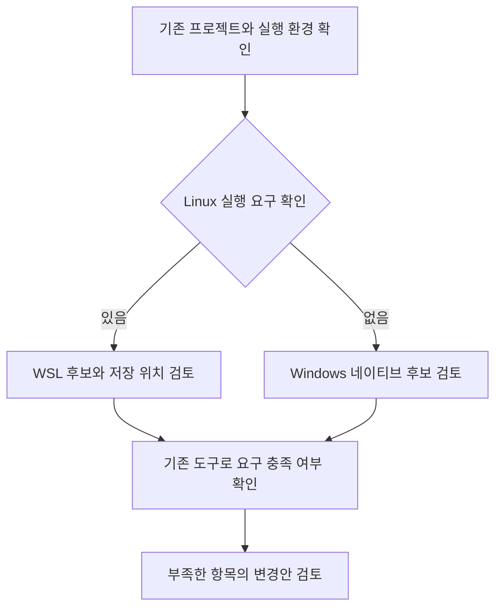

# Windows 개발 환경 검토 범위

기준일: 2026-11-17.
이 문서는 Windows 개발 환경 권고안을 만들기 위한 초기 검토 범위를 정한다.
확정 권고안이나 설치 실행 절차는 후속 조사에서 작성한다.
로컬 Codex 플러그인의 환경 진단·설정·일상 사용 지원은 기획 대상이다.
이 문서는 해당 기능의 구현 여부를 보증하지 않는다.

## 공식 문서에서 확인한 사실

Microsoft는 Windows 개발 환경 안내에서 언어별 설정 지침과 WSL·터미널 등의 도구를 소개한다. [Windows 개발 환경](https://learn.microsoft.com/en-us/windows/dev-environment/)
Microsoft는 Linux 명령줄로 작업할 때 WSL 파일 시스템에 프로젝트를 보관하도록 권고한다. [WSL 파일 시스템](https://learn.microsoft.com/en-us/windows/wsl/filesystems)
같은 문서는 Windows 명령줄로 작업할 때 Windows 파일 시스템에 프로젝트를 보관하도록 권고한다. [WSL 파일 시스템](https://learn.microsoft.com/en-us/windows/wsl/filesystems)
이는 공식 문서의 권고이며 이 저장소에서 측정한 성능 결과는 아니다.
WinGet은 Windows 애플리케이션의 검색·설치·업그레이드 등을 지원하는 명령줄 도구다. [WinGet 안내](https://learn.microsoft.com/en-us/windows/package-manager/winget/)
App Installer가 설치되지 않은 장치도 있으므로 WinGet의 사용 가능 여부는 확인해야 한다. [WinGet 설치 조건](https://learn.microsoft.com/en-us/windows/package-manager/winget/)
PowerShell 7은 Windows PowerShell 5.1과 별도 디렉터리에 설치되어 함께 실행될 수 있다. [PowerShell 설치](https://learn.microsoft.com/en-us/powershell/scripting/install/install-powershell-on-windows)
Microsoft는 요구와 작업 방식에 맞는 PowerShell 설치 방법을 선택하도록 안내한다. [PowerShell 설치 방법](https://learn.microsoft.com/en-us/powershell/scripting/install/install-powershell-on-windows)

## 저장소의 잠정 제안

Windows 네이티브 실행 환경을 첫 번째 검토 후보로 삼는다.
후보 구성은 Windows 파일 시스템의 프로젝트와 호환되는 셸 및 기존 개발 도구로 정의한다.
특정 셸·터미널·런타임·버전 관리자의 제품 선정은 후속 조사에 남긴다.
Linux 전용 의존성이나 프로젝트의 Linux 실행 요구가 확인되면 WSL을 후보로 검토한다.
프로젝트가 이미 WSL을 기준으로 운영된다면 기존 구성을 먼저 평가한다.
WSL 선택 시 주로 사용하는 명령줄과 프로젝트 저장 위치를 함께 검토한다.
기존 프로젝트를 자동으로 이동하는 정책은 제안하지 않는다.

## 기존 환경 보존 원칙

프로젝트가 지정한 도구 버전과 패키지 관리자를 우선한다.
잠금 파일과 기존 개발 안내에서 프로젝트의 선택을 확인한다.
일관된 외형만을 위해 새 버전 관리자를 도입하지 않는다.
통일만을 목적으로 기존 패키지 관리자를 교체하지 않는다.
정상 작동하는 도구가 요구를 충족하면 중복 설치를 피한다.
명령을 찾지 못한 경우 설치 부재와 경로 해석 문제를 구분한다.
특정 설치 경로나 최신 버전을 일괄 필수 조건으로 삼지 않는다.
설치가 필요한 항목의 방법은 호환성과 사용자 환경을 조사한 뒤 결정한다.

## 관찰 가능한 진단 항목

다음 항목은 향후 진단 설계의 후보이며 현재 구현된 검사 목록은 아니다.
현재 OS의 종류·버전·아키텍처와 Windows 또는 WSL 실행 문맥을 기록한다.
현재 셸의 실행 파일 경로와 버전을 기록한다.
프로젝트의 절대 경로와 Windows 또는 WSL 파일 시스템 위치를 기록한다.
대상 명령이 실제로 해석되는 경로와 같은 이름의 다른 후보 경로를 확인한다.
도구의 버전 출력과 명령 종료 결과를 프로젝트 요구 버전과 대조한다.
기존 패키지 관리자와 잠금 파일의 일치 여부를 확인한다.
일상 사용 진단에서는 셸이나 프로젝트 위치 변경에 따른 관찰값 차이를 확인하는 방안을 검토한다.
판정에는 실행 문맥·관찰 결과·기대 조건을 함께 남기는 방안을 검토한다.
원인 가설에는 재현 절차와 가설이 틀렸다고 판단할 조건을 붙인다.

## 후속 결정과 미확인 사항

지원할 Windows 버전과 아키텍처 범위를 결정해야 한다.
후보 도구의 구체적인 이름과 지원 버전을 조사해야 한다.
WSL 선택 기준은 대상 프로젝트의 실제 의존성과 운영 조건으로 검증해야 한다.
기존 도구의 정상 작동을 판정할 최소 확인 절차를 정의해야 한다.
설정 변경의 제시 방식과 적용 범위는 플러그인 설계에서 결정해야 한다.
각 사용자의 설치 상태와 프로젝트 호환성은 공식 문서만으로 확정할 수 없다.
환경 간 성능 차이는 비교 가능한 작업과 측정 조건을 정한 뒤 검증해야 한다.
